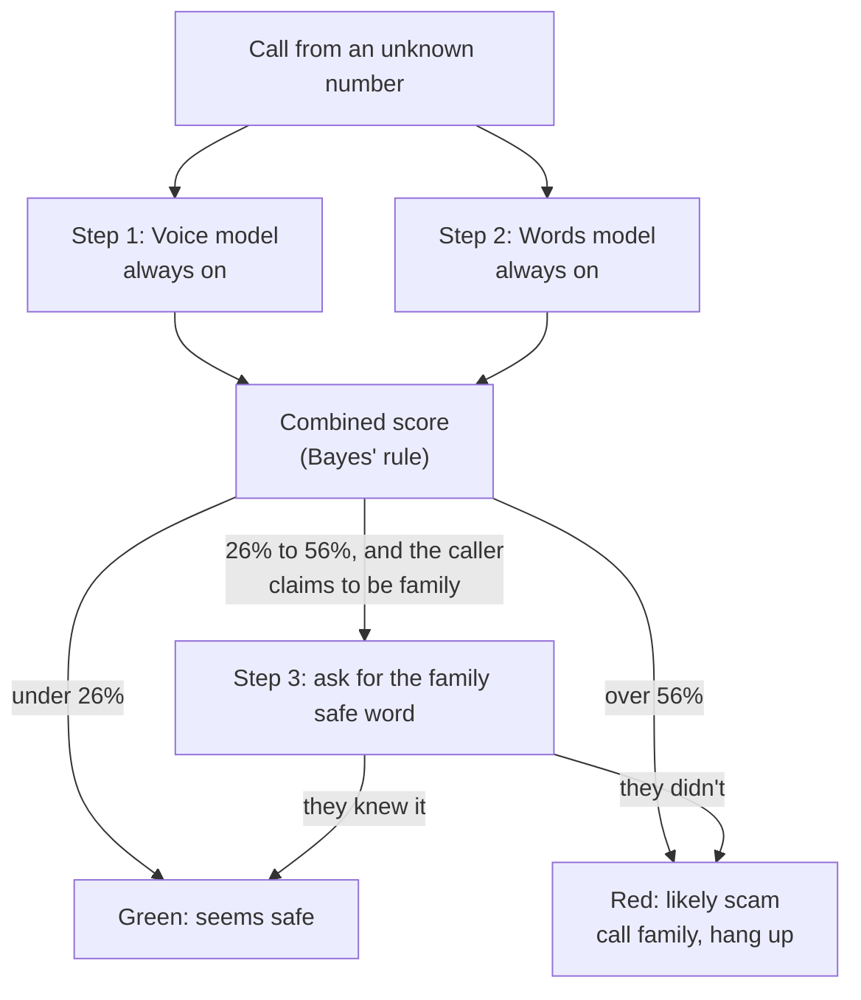
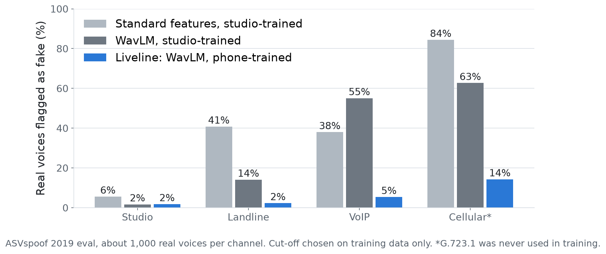

# Liveline

Liveline screens phone calls to older adults from numbers they don't know. While the call is happening, it shows one color: **green** (seems safe), **yellow** (check first), or **red** (likely scam), with one sentence saying why and a button that calls the real family member. A family app gets an alert on red calls and handles all the setup.

We're Parth Rana and Joseph David, and we built it for the 2026 Congressional App Challenge (MN-04). It's a prototype: the models are trained and measured, but real phone calls aren't connected yet.

**Try it:** https://porth-bot.github.io/congressional-app-challenge/ (on Home, press "Watch a scam call")

## How it decides: three steps



1. **Voice.** A model listens for a computer-made voice. Phone networks throw away much of the sound that deepfake detectors rely on, so we measured that and trained on phone-quality copies.
2. **Words.** A model reads what the caller says and scores scam tactics: secrecy, urgency, gift cards, bail, and so on. It works however bad the line is, so it also catches human scammers.
3. **Safe word.** A scammer can copy a voice, but can't know the family's word. Asking costs effort, so Liveline only asks when steps 1 and 2 are unsure, and only when the caller claims to be family. The word is shown on screen, so nobody has to remember it under pressure. A correct word still doesn't clear a call that asks for money.

Bayes' rule combines the steps, starting from an assumed 1-in-10 chance that an unknown caller claiming to be family is a scam. One thing we learned: a real-sounding voice can lower that by at most half, because human scammers have real voices too.

**This is the design. In this demo** the words model runs live in your browser on every caller line (type your own in the Live call), while the voice step uses the voice model's typical output for that kind of voice, because no call audio is connected yet.

## What we measured

All numbers come from scripts in [research/](research/). The full write-up, with intervals and caveats, is [research/RESULTS.md](research/RESULTS.md).

| Question | Result |
|---|---|
| Do people hear deepfakes? | In a public 2026 study (35,532 judgments), listeners called 29% of fake voices real and 36% of real voices fake. |
| Does phone audio break a detector? | With its cut-off set on studio audio, a WavLM-based detector flagged **63%** of real voices as fake on a phone codec it never saw. Re-setting the cut-off on phone audio cut that to 24%; also training on phone-quality copies cut it to **14%** and lowered the error rate from 20% to 17%. The cost: missed fakes rose from 4% to 20%. |
| What about breathing and pause cues? | They barely separated real from fake even in the studio, and lost all of it on the phone. A pretrained speech model (WavLM) did far better. |
| Is voice enough on its own? | No. On real internet deepfakes over a phone line it is still wrong 21% to 29% of the time, and phone training didn't help there. |
| Does the words model work? | AUC 0.88 to 0.90 on two public scam-dialogue sets it never saw (one AI-generated, one with no documented source), and 0.98 on held-out AI-written family-emergency calls. We have no real grandparent-scam transcripts to test on. |
| Does combining help? | Voice gives an earlier warning: with 10% of a call heard, adding it raised AUC (95% interval +0.01 to +0.10). By the end of a call, words alone did as well. |
| What does the safe word do? | Steps 1 and 2 sent 87% to 89% of scam test calls and 20% of real family calls to step 3. What happens next depends on how often scammers know a family's word, which we haven't measured; RESULTS.md shows the outcome under several assumptions. |



## What's real and what isn't

- **Real:** the codec benchmark, the voice model, the words model, the fusion math, the cut-offs, and every number above.
- **Live in the app:** every caller line is scored by the trained words model as it appears.
- **Scripted:** the caller's lines in the four test calls, and their voice evidence (the voice model's median output on real phone-quality clips of that kind of voice).
- **Assumed:** the 1-in-10 starting chance, that half of family-impersonation scams use a cloned voice, and how often families and scammers know the safe word.
- **AI-written or AI-generated:** nearly all the text data. No public dataset has grandparent-scam calls, so our family-emergency calls were written with AI. Two of the three public scam-dialogue sets were generated by language models, and the third doesn't say where it came from. Treat those results as a check of the design, not a real-world rate.
- **Not built yet:** routing real calls through a phone number, family voice matching, measuring the safe word with real families, and a pilot with seniors. Call history starts with sample data.

## Other tools

Hiya's AI Voice Detection flags synthetic voices on live calls, and Google's Pixel Scam Detection flags scam-like conversation on the phone. ASVspoof 2021 already studied how phone codecs hurt deepfake detectors. Liveline puts voice and words together with a family safe-word step for an older adult and their family, and our codec study is a small rebuild to choose a model. We haven't compared it head to head with those tools.

## Run it

The app is one file, `atelier-securities.html`. It's a page fragment, because the artifact host adds the `<!doctype>` and `<head>`. To preview it locally:

```bash
./.build-preview.sh
```

```bash
python3 -m http.server 8878 --bind 127.0.0.1
```

Then open http://127.0.0.1:8878/preview.html. Use Chrome if you want to speak in the Live call; typing and the example lines work everywhere.

To rebuild the research, see [research/README.md](research/README.md).

## Repo map

| Path | What it is |
|---|---|
| `atelier-securities.html` | The whole app: CSS, screens, and scripts |
| `research/stage1/` | Voice study: data download, phone codecs, features, WavLM, benchmark, intervals |
| `research/stage2/` | Words model: training, calibration, and the browser version (`stage2_model.js`) |
| `research/fusion/` | Combining the steps, the safe-word simulation, and the app's voice constants |
| `research/results/` | Figures and the JSON every quoted number comes from (`headline.json`) |
| `research/embed_model.py` | Copies the trained words model into the app |
| `.github/workflows/pages.yml` | Publishes the app to GitHub Pages on every push to `main` |

Inside the app's script:

- `ROUTES` lists the screens (`#home`, `#simulator`, `#learn-scoring` and so on).
- `SC` holds the test calls. Each caller line goes through `Stage2.scoreTranscript`, and voice evidence comes from `VOICE_LLR`.
- `posterior()` multiplies the starting odds by each step's likelihood ratio. `T_WARN` and `T_STOP` are the 26% and 56% cut-offs, `LR_SAID` and `LR_DIDNT` are step 3's weights, and `shownBand()` decides what Rose's screen shows.
- The block between `<!-- stage2:start -->` and `<!-- stage2:end -->` is the trained words model, generated by `research/embed_model.py`. Don't edit it by hand.
- State saves to `localStorage` under `liveline-demo-v3`.
