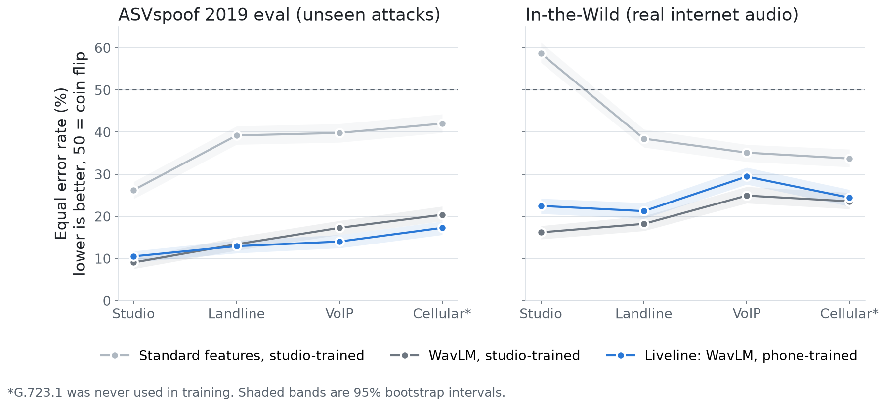

# Liveline results

Every number here comes from a script in this folder; the JSON it was read from is named next to it. Where a result went against our plan, it is reported as it came out. One exception to "test data never shaped a decision" is flagged in Stage 2: after our first words model raised no alarms on the family test calls, we changed how it is calibrated, so the family-call numbers are somewhat optimistic.

## Summary

- **Phone audio breaks a studio-tuned detector.** With its cut-off set on studio audio, a strong detector flagged 63% of real voices as fake on a phone codec it never saw. Re-setting the cut-off on phone copies of the training clips cut that to 24%; also training on those copies cut it to 14% and lowered the error rate from 20% to 17%. The cost: missed fakes rose from 4% to 20%.
- **The breath and pause cues we planned on don't survive the phone.** A pretrained speech model (WavLM) does far better, but on real internet deepfakes over a phone line it is still wrong 21% to 29% of the time, and phone training didn't help there. Voice can't decide alone.
- **A words model catches what voice can't,** including human scammers. Nearly all our text data is AI-generated: AUC 0.88 to 0.90 on two public scam-dialogue sets it never saw (one AI-generated, one with no documented source), and 0.98 on held-out AI-written family-emergency calls. We have no real grandparent-scam transcripts.
- **Voice helps early; words carry the end.** On paired test calls, adding voice raised AUC with 10% of a call heard (95% interval +0.01 to +0.10, resampling speakers and transcripts). By the end of the call, words alone did as well, even at the same false-alarm rate.
- **The safe-word step is where scams get stopped, but its effect is assumed.** Steps 1 and 2 sent 87% to 89% of scam test calls and 20% of real family calls to step 3. What happens next depends on how often scammers know a family's word, which we haven't measured.

## Why this matters: people struggle to hear the difference

From the public data of Müller and Choong's 2026 listening study (`human/human_baseline.py` -> `results/human_baseline.json`): across 35,532 judgments by 1,768 listeners, people called 29% of computer-made voices real and called 36% of real voices fake (69% right overall). Ears fail in both directions, and the second one matters for a grandparent too: a false alarm on a real grandchild is a failure.

## Stage 1: the voice model on phone audio

### What we did

- **Data.** 6,000 clips, half real and half computer-made: 2,000 from the ASVspoof 2019 LA training split (attacks A01 to A06, 20 speakers), 2,000 from its evaluation split (13 attack systems A07 to A19, 67 new speakers; A16 and A19 reuse the training algorithms A04 and A06, so 11 are new algorithms), and 2,000 from In-the-Wild (real and deepfake audio of 53 celebrities and politicians collected from the internet). Spoofed training clips are balanced across attack systems.
- **Phone channel.** Every clip went through a real ffmpeg encode/decode round trip in three codecs: G.711 mu-law with a 300 to 3,400 Hz band (landline), Opus narrowband at 8 kbps (VoIP and app calling), and G.723.1 at 6.3 kbps (a low-bitrate CELP codec, our stand-in for cellular AMR-NB, which ffmpeg cannot encode). G.723.1 is never used for training, so it is also an unseen-codec test.
- **Silence.** Leading and trailing silence is trimmed before anything is measured, because ASVspoof 2019 leaks the label through it (Müller et al., 2021).
- **Features.** 25 interpretable "voice biology" and spectral features (pitch statistics and micro-variation from Praat, jitter, shimmer, harmonics-to-noise, voicing, pause rate and length, breath and noise level between phrases, syllable rate, rhythm, spectral shape, energy above 4 kHz and below 300 Hz) and 100 cepstral statistics (means and spreads of MFCC, delta-MFCC, LFCC). With gradient boosting these make "our MFCC/LFCC summary baseline"; it is weaker than the official ASVspoof LFCC-GMM baseline, which models frames rather than clip averages.
- **Learned features.** Frozen WavLM Base+ (Microsoft; self-supervised on 94,000 hours of speech, never trained on deepfakes). Each clip is cropped or repeat-padded to 4 s and every layer's output is averaged over time. Layer 4 was chosen by speaker-grouped 5-fold cross-validation on the training split (CV EER 4.45%, see `results/ssl_layer_selection.json`).
- **Models.** Gradient-boosted trees on the handcrafted features; logistic regression on WavLM features. Each trained twice: on studio audio only ("studio-trained") and on studio plus G.711 and Opus copies ("phone-trained").
- **No peeking.** Feature selection, the WavLM layer, every cut-off, and every hyperparameter come from the training split. The fixed cut-off for false-alarm rates is the equal-error point of each model's out-of-fold training scores.

### What we found

1. **Breath and pause cues do not survive the phone, and were weak to begin with.** Measured on the training split, the four pause and breath features separated real from fake by 0.04 to 0.07 on studio audio (0 = coin flip, 1 = perfect) and by -0.05 to -0.02 after the worse of the two training codecs. Spectral flatness fell from 0.34 to 0.19 and energy above 4 kHz from 0.09 to 0.06. Only pitch variability (0.32 to 0.32) and pitch range (0.24 to 0.23) passed our pre-set survival rule (at least 0.2 under both training codecs). See `results/fig_survival.png`.
2. **Hand-measured features are not enough.** The best handcrafted model (all 125 features, phone-trained) had a 36.0% EER on the unseen cellular codec; WavLM features had 17.3%. Keeping only codec "survivors" did not beat simply training on phone audio with every feature (38.1% vs 36.0% EER on G.723.1). Our original plan of building the detector from surviving biology features alone did not work, and we report that.
3. **Studio-tuned detectors break on phone audio.** On ASVspoof eval, EER rose from 26.3% to 42.0% (our MFCC/LFCC summary baseline) and from 9.1% to 20.4% (WavLM) between studio and G.723.1 audio. Worse, at the cut-off chosen on studio training data, the studio-trained WavLM model flagged 62.7% of real voices as fake on G.723.1 (1.7% on studio audio).
4. **Most of the fix is the cut-off; phone training adds the rest.** Results on ASVspoof eval, G.723.1, with 95% intervals that resample speakers (`stage1/cluster_ci.py` -> `results/cluster_ci.json`):

   | WavLM model, cut-off source | Real voices flagged | Fakes missed | Balanced accuracy | EER |
   |---|---|---|---|---|
   | Studio-trained, studio cut-off | 63% (56 to 71) | 4% (3 to 6) | 66% (63 to 70) | 20% (18 to 23) |
   | Studio-trained, cut-off reset on phone copies of the training clips (control) | 24% (18 to 31) | 18% (14 to 21) | 79% (76 to 82) | 20% (18 to 23) |
   | Phone-trained (shipped) | 14% (10 to 19) | 20% (16 to 23) | 83% (81 to 85) | 17% (15 to 19) |

   Against the studio cut-off, phone training raised balanced accuracy by 16.6 points (13.8 to 19.4) and lowered EER by 3.1 points (1.9 to 5.1), both clear of zero. About three quarters of the accuracy gain comes from the cut-off alone. Phone training costs a little on studio audio (EER 10.5% vs 9.1%).
5. **Real internet deepfakes are still hard, and phone training didn't help there.** On In-the-Wild, the phone-trained WavLM model's EER is 21.2% to 29.4% across phone codecs. The studio-trained model is slightly better on landline and VoIP (EER difference +0.5 to +5.9 and +0.5 to +8.2 points, speaker-level intervals) and about the same on G.723.1 (-2.9 to +2.8). At the cut-off from ASVspoof training, the phone-trained model still flags 24% to 56% of real In-the-Wild voices. A voice score alone is not reliable enough to tell a grandparent a call is fake, which is why Liveline combines it with the words and never shows the voice score as a verdict.
6. **About the intervals below.** The tables generated by `report.py` use bootstrap intervals that resample clips. Clips share speakers and recordings across channels, so those intervals are too narrow, and we no longer quote the McNemar p-values from them. Use `results/cluster_ci.json` for the headline comparisons.

### All numbers

Generated by `stage1/report.py benchmark_ssl` from `results/benchmark_ssl.json`.

#### ASVspoof 2019 eval: equal error rate, % (95% CI)

| Model | Studio | Landline | VoIP | Cellular* |
|---|---|---|---|---|
| Standard cepstral features (MFCC/LFCC), studio-trained | 26.3 (24.2-28.2) | 39.2 (37.1-41.4) | 39.8 (37.6-42.0) | 42.0 (39.9-44.3) |
| All 125 handcrafted features, studio-trained | 25.5 (23.6-27.5) | 37.3 (35.2-39.7) | 38.4 (36.5-40.7) | 39.3 (37.3-41.4) |
| Voice-biology + spectral features, studio-trained | 35.5 (33.6-37.8) | 34.5 (32.5-36.7) | 38.4 (36.1-40.6) | 38.6 (36.6-40.8) |
| Standard cepstral features, phone-trained | 28.6 (26.6-30.6) | 37.6 (35.5-39.8) | 36.0 (34.1-38.1) | 40.2 (38.1-42.5) |
| All 125 handcrafted features, phone-trained | 26.0 (24.3-28.2) | 32.9 (31.1-35.4) | 33.9 (31.8-36.0) | 36.0 (33.9-37.9) |
| Voice-biology + spectral features, phone-trained | 35.6 (33.8-37.9) | 34.2 (31.9-36.3) | 38.1 (35.9-40.2) | 37.5 (35.1-39.4) |
| Codec survivors only (20 features), phone-trained | 35.1 (33.0-37.2) | 38.6 (36.3-40.6) | 39.4 (37.1-41.3) | 38.1 (36.3-40.5) |
| Surviving biology features only (2), phone-trained | 43.2 (41.2-45.2) | 43.1 (40.9-45.4) | 43.6 (41.5-45.6) | 43.2 (41.1-45.4) |
| WavLM embedding, studio-trained | 9.1 (7.6-10.1) | 13.4 (11.9-15.1) | 17.3 (15.6-19.0) | 20.4 (18.9-22.4) |
| WavLM embedding, phone-trained | 10.5 (9.1-11.8) | 12.9 (11.3-14.3) | 14.0 (12.5-15.6) | 17.3 (15.6-18.8) |

#### ASVspoof 2019 eval: real voices flagged as fake at the training threshold, %

| Model | Studio | Landline | VoIP | Cellular* |
|---|---|---|---|---|
| Standard cepstral features (MFCC/LFCC), studio-trained | 5.6 | 40.8 | 38.0 | 84.4 |
| All 125 handcrafted features, studio-trained | 4.2 | 27.7 | 36.1 | 70.3 |
| Voice-biology + spectral features, studio-trained | 26.4 | 79.3 | 79.1 | 89.6 |
| Standard cepstral features, phone-trained | 9.4 | 32.9 | 31.3 | 60.1 |
| All 125 handcrafted features, phone-trained | 8.3 | 25.0 | 27.0 | 52.9 |
| Voice-biology + spectral features, phone-trained | 26.6 | 23.1 | 32.7 | 40.3 |
| Codec survivors only (20 features), phone-trained | 20.6 | 27.2 | 26.2 | 55.5 |
| Surviving biology features only (2), phone-trained | 33.3 | 30.0 | 33.3 | 31.3 |
| WavLM embedding, studio-trained | 1.7 | 14.1 | 55.1 | 62.7 |
| WavLM embedding, phone-trained | 1.8 | 2.3 | 5.4 | 14.3 |

#### ASVspoof 2019 eval: fake voices missed at the training threshold, %

| Model | Studio | Landline | VoIP | Cellular* |
|---|---|---|---|---|
| Standard cepstral features (MFCC/LFCC), studio-trained | 41.1 | 37.7 | 41.5 | 8.9 |
| All 125 handcrafted features, studio-trained | 42.3 | 45.0 | 41.4 | 17.1 |
| Voice-biology + spectral features, studio-trained | 45.3 | 7.5 | 7.3 | 2.6 |
| Standard cepstral features, phone-trained | 40.5 | 41.9 | 40.6 | 21.9 |
| All 125 handcrafted features, phone-trained | 42.5 | 42.0 | 39.7 | 23.1 |
| Voice-biology + spectral features, phone-trained | 46.4 | 47.2 | 43.0 | 32.5 |
| Codec survivors only (20 features), phone-trained | 47.2 | 47.0 | 48.2 | 25.0 |
| Surviving biology features only (2), phone-trained | 54.5 | 59.9 | 54.7 | 57.1 |
| WavLM embedding, studio-trained | 18.7 | 12.5 | 3.5 | 4.4 |
| WavLM embedding, phone-trained | 25.6 | 25.1 | 24.6 | 19.6 |

#### In-the-Wild: equal error rate, % (95% CI)

| Model | Studio | Landline | VoIP | Cellular* |
|---|---|---|---|---|
| Standard cepstral features (MFCC/LFCC), studio-trained | 58.7 (56.5-61.3) | 38.4 (36.4-40.7) | 35.1 (33.0-37.0) | 33.7 (31.7-35.9) |
| All 125 handcrafted features, studio-trained | 59.4 (57.3-61.5) | 37.2 (35.0-39.4) | 35.8 (33.7-38.0) | 32.4 (30.5-34.7) |
| Voice-biology + spectral features, studio-trained | 36.5 (34.4-38.6) | 43.5 (41.3-45.8) | 40.4 (38.2-42.8) | 38.3 (36.2-40.8) |
| Standard cepstral features, phone-trained | 58.7 (56.4-60.7) | 43.6 (41.5-45.8) | 42.5 (40.3-44.8) | 35.2 (32.8-37.1) |
| All 125 handcrafted features, phone-trained | 53.3 (51.1-55.7) | 39.9 (37.9-42.1) | 38.8 (36.8-41.2) | 30.7 (28.4-32.7) |
| Voice-biology + spectral features, phone-trained | 39.3 (37.2-41.5) | 42.7 (40.9-45.1) | 40.1 (37.7-42.3) | 38.0 (35.8-40.2) |
| Codec survivors only (20 features), phone-trained | 62.8 (60.6-64.8) | 43.4 (41.1-45.5) | 37.0 (34.9-39.3) | 32.3 (30.4-34.6) |
| Surviving biology features only (2), phone-trained | 43.8 (41.2-45.6) | 45.5 (43.3-47.8) | 44.9 (42.6-47.2) | 44.8 (42.7-47.0) |
| WavLM embedding, studio-trained | 16.2 (14.6-17.8) | 18.2 (16.6-20.1) | 24.9 (23.1-27.0) | 23.6 (21.8-25.6) |
| WavLM embedding, phone-trained | 22.5 (20.6-24.2) | 21.2 (19.5-23.2) | 29.4 (27.6-31.6) | 24.4 (22.4-26.3) |

#### In-the-Wild: real voices flagged as fake at the training threshold, %

| Model | Studio | Landline | VoIP | Cellular* |
|---|---|---|---|---|
| Standard cepstral features (MFCC/LFCC), studio-trained | 90.0 | 38.5 | 40.4 | 69.3 |
| All 125 handcrafted features, studio-trained | 88.7 | 28.7 | 39.7 | 53.2 |
| Voice-biology + spectral features, studio-trained | 52.1 | 83.3 | 86.7 | 90.5 |
| Standard cepstral features, phone-trained | 77.4 | 34.5 | 31.5 | 43.0 |
| All 125 handcrafted features, phone-trained | 69.7 | 32.0 | 32.0 | 38.6 |
| Voice-biology + spectral features, phone-trained | 45.9 | 43.6 | 51.8 | 57.6 |
| Codec survivors only (20 features), phone-trained | 31.3 | 30.3 | 33.0 | 34.9 |
| Surviving biology features only (2), phone-trained | 33.0 | 28.5 | 33.6 | 31.7 |
| WavLM embedding, studio-trained | 33.1 | 46.9 | 94.3 | 88.0 |
| WavLM embedding, phone-trained | 24.4 | 24.4 | 56.1 | 51.3 |

#### In-the-Wild: fake voices missed at the training threshold, %

| Model | Studio | Landline | VoIP | Cellular* |
|---|---|---|---|---|
| Standard cepstral features (MFCC/LFCC), studio-trained | 11.6 | 38.3 | 29.4 | 11.1 |
| All 125 handcrafted features, studio-trained | 13.4 | 46.1 | 31.9 | 18.6 |
| Voice-biology + spectral features, studio-trained | 25.9 | 6.4 | 5.0 | 2.7 |
| Standard cepstral features, phone-trained | 30.8 | 55.8 | 60.8 | 26.0 |
| All 125 handcrafted features, phone-trained | 30.1 | 52.5 | 47.5 | 22.7 |
| Voice-biology + spectral features, phone-trained | 35.3 | 42.2 | 32.6 | 28.2 |
| Codec survivors only (20 features), phone-trained | 87.6 | 60.6 | 42.0 | 30.1 |
| Surviving biology features only (2), phone-trained | 54.0 | 63.4 | 58.2 | 61.1 |
| WavLM embedding, studio-trained | 5.2 | 4.5 | 0.3 | 1.7 |
| WavLM embedding, phone-trained | 20.8 | 17.5 | 8.7 | 5.6 |

#### Cross-validated EER on ASVspoof train (speaker-grouped 5-fold), %

- Standard cepstral features (MFCC/LFCC), studio-trained: 12.9
- All 125 handcrafted features, studio-trained: 12.4
- Voice-biology + spectral features, studio-trained: 32.2
- Standard cepstral features, phone-trained: 21.5
- All 125 handcrafted features, phone-trained: 20.9
- Voice-biology + spectral features, phone-trained: 33.6
- Codec survivors only (20 features), phone-trained: 29.9
- Surviving biology features only (2), phone-trained: 41.4
- WavLM embedding, studio-trained: 2.9
- WavLM embedding, phone-trained: 4.4

#### McNemar tests (exact), accuracy at each model's training threshold

- survivors_aug vs cepstral_clean, asv_test/g711: 62.9% vs 60.7%, p = 0.077
- survivors_aug vs cepstral_clean, asv_test/g723: 59.7% vs 53.3%, p = 1.3e-07
- survivors_aug vs cepstral_clean, itw/g711: 54.6% vs 61.6%, p = 6.8e-08
- survivors_aug vs cepstral_clean, itw/g723: 67.5% vs 59.8%, p = 4.5e-09
- survivors_aug vs all_aug, asv_test/g711: 62.9% vs 66.5%, p = 0.0018
- survivors_aug vs all_aug, asv_test/g723: 59.7% vs 62.0%, p = 0.049
- survivors_aug vs all_aug, itw/g711: 54.6% vs 57.7%, p = 0.0097
- survivors_aug vs all_aug, itw/g723: 67.5% vs 69.3%, p = 0.11
- all_aug vs all_clean, asv_test/g711: 66.5% vs 63.6%, p = 0.011
- all_aug vs all_clean, asv_test/g723: 62.0% vs 56.3%, p = 1.5e-06
- all_aug vs all_clean, itw/g711: 57.7% vs 62.6%, p = 9.9e-06
- all_aug vs all_clean, itw/g723: 69.3% vs 64.1%, p = 1.2e-06
- cepstral_aug vs cepstral_clean, asv_test/g711: 62.6% vs 60.7%, p = 0.088
- cepstral_aug vs cepstral_clean, asv_test/g723: 59.0% vs 53.3%, p = 4.6e-07
- cepstral_aug vs cepstral_clean, itw/g711: 54.8% vs 61.6%, p = 7.8e-10
- cepstral_aug vs cepstral_clean, itw/g723: 65.5% vs 59.8%, p = 7.2e-07
- ssl_aug vs ssl_clean, asv_test/g711: 86.3% vs 86.7%, p = 0.71
- ssl_aug vs ssl_clean, asv_test/g723: 83.1% vs 66.4%, p = 1.4e-41
- ssl_aug vs ssl_clean, itw/g711: 79.1% vs 74.3%, p = 2.9e-06
- ssl_aug vs ssl_clean, itw/g723: 71.5% vs 55.1%, p = 2.7e-63
- ssl_aug vs survivors_aug, asv_test/g711: 86.3% vs 62.9%, p = 5.4e-73
- ssl_aug vs survivors_aug, asv_test/g723: 83.1% vs 59.7%, p = 4.5e-57
- ssl_aug vs survivors_aug, itw/g711: 79.1% vs 54.6%, p = 2.3e-60
- ssl_aug vs survivors_aug, itw/g723: 71.5% vs 67.5%, p = 0.0059

## Stage 2: the scam-language model

Full report: [stage2/RESULTS.md](stage2/RESULTS.md). In short:

- **Model.** The caller's words only, normalized (names and greetings neutralized), word 1-2 grams, TF-IDF, logistic regression (5,000 n-grams, `model.json` about 150 KB). It runs in the browser, and the JavaScript matches Python to within 1e-15.
- **Data. Nearly all of it is machine-written.** BothBosu's scam and normal call dialogues were generated by Llama-3-70B, shakeleoatmeal's by a Llama-8B model, and our 320 family-emergency calls by AI (no public set has grandparent scams). menaattia's source isn't documented. The only real transcripts we have are 20 scambaiting calls, all scams, so we can't report a real-world false-alarm rate. A leakage audit found and removed 177 test calls that were near-copies of training calls.
- **Ranking.** AUC on held-out family-emergency calls 0.978 (version 1, before family calls were added: 0.814). On the two other public sets it never trained on, the shipped model scores 0.884 (shakeleoatmeal) and 0.900 (menaattia); version 2's pooled calibration scored 0.930 and 0.902.
- **Alarms, and a test set that is no longer clean.** Version 2 ranked well but never raised an alarm on family scams. That test result is what prompted version 2.1, which is calibrated on the held-out family validation calls, with no evidence before any words are heard. The calibration was fit on validation data only, but the decision to change it came from looking at the family test set, so treat the family numbers as development results: 100% of family test scams reached yellow and 87.5% reached red, while 42.5% of real family calls reached yellow and 7.5% reached red. On calls unlike family calls (shakeleoatmeal) this calibration flags almost everything, so it only fits Liveline's use.

## Fusion: does combining voice and words help?

`fusion/fusion.py` -> `results/fusion.json`, figure `results/fig_fusion.png`.

**Test calls.** No public dataset has phone calls with both audio and transcripts of grandparent scams, so each test call pairs a held-out In-the-Wild voice clip (sent through a random phone codec) with a held-out transcript: real family call = real voice + normal transcript; voice-clone scam = computer-made voice + scam transcript; human impostor = real voice + scam transcript (mix 50/25/25, 4,000 calls). Pairing at random makes the stages independent by construction, so this tests whether the fusion math does its job, not whether real scams satisfy the independence assumption.

**The math.** Starting odds of 1 in 10 for an unknown number, times each stage's likelihood ratio. Two lessons came out of building it:
1. *A real voice is weak evidence of safety.* Our first version treated "sounds real" as strong evidence of "not a scam". Human scammers have real voices. If a share pi of scams use a cloned voice, the voice's likelihood ratio for "scam" is pi * LR_fake + (1 - pi), so a real-sounding voice can lower the odds by at most a factor of (1 - pi). We use pi = 0.5, an assumption.
2. *Calibration decides whether fusion helps.* The voice model's probabilities, calibrated on ASVspoof, were overconfident on real internet audio. Calibrating them on one half of the In-the-Wild speakers and testing on the other half (no speaker in both) fixed it.

Both effects, on the family-emergency test calls at the end of the call (AUC; words alone 0.98): naive rule with ASVspoof-calibrated voice 0.85; mixture rule, same voice calibration 0.92; naive rule with In-the-Wild-calibrated voice 0.96; mixture rule with In-the-Wild-calibrated voice (shipped) 0.98. All four are in `fusion.json` (`fused_naive` and `fused` under each calibration).

**Results on family-emergency calls** (voice calibrated on the other In-the-Wild speakers; transcripts AI-written):

| Share of call heard | Voice only | Words only | Combined |
|---|---|---|---|
| 10% | 0.65 | 0.59 | 0.65 |
| 30% | 0.65 | 0.73 | 0.76 |
| 50% | 0.65 | 0.86 | 0.87 |
| 100% | 0.65 | 0.98 | 0.98 |

AUC, scam vs real family call. Voice alone is capped because half the scams use real voices.

How sure are we? The 4,000 test calls reuse 80 transcripts and 26 voice speakers, so the intervals in `fusion.json` under `cluster_auc` resample speakers and transcripts rather than calls. The gain from adding voice (combined minus words alone) is:

| Share of call heard | Family calls | Public transcripts |
|---|---|---|
| 10% | +0.007 to +0.102 | +0.051 to +0.121 |
| 30% | -0.008 to +0.069 | +0.020 to +0.071 |
| 50% | -0.019 to +0.029 | -0.005 to +0.036 |
| 100% | -0.010 to +0.005 | -0.013 to +0.015 |

So voice gives an earlier warning, before the caller has asked for anything, and adds nothing by the end of the call. The mixture rule with pi = 0.5 was also tested on calls built with exactly half cloned voices, which flatters it a little.

**Learned weights.** When we let logistic regression learn how much to trust each stage on validation calls, it chose 0.88 for voice and 0.78 for words, close to plain Bayes (1 and 1), so the app keeps the plain rule.

**The app's cut-offs** (yellow at 26%, red at 56% combined probability) were set on validation calls (the In-the-Wild calibration-half voices and Stage 2's cross-fitted family validation transcripts) so that at most 10% of real family calls ever turn yellow and 2% ever turn red. On the test calls, steps 1 and 2 turned 88% of voice-clone scams and 81% of impostor scams red at some point, while 21% of real family calls turned yellow and 6% red. Both false-alarm rates are above the validation targets (10% and 2%), which is what small validation sets do.

At the same rate of family calls turning red (6%), words alone catch about as many: 89% of clones and 91% of impostors (`matched_red` in `fusion.json`). Compared at each system's own cut-offs, words alone looked worse (74% and 75%), but only because its cut-offs allowed fewer red false alarms (3%). We don't claim that voice raises the end-of-call catch rate.

**On the public transcripts** (not family calls) combining matched words alone by the end of the call (AUC 0.78 vs 0.78) and helped early (0.65 vs 0.60 at 30%). The family-tuned cut-offs do not transfer: 16% of real calls turned red there.

**Caveats.** The `auc` intervals under `by_prefix` in `fusion.json` resample paired calls and are too narrow; use `cluster_auc`. The "real family" voices are celebrity and politician recordings from In-the-Wild, not family members.

## Step 3: the safe word

`fusion/fusion.py` (`cascade()`) -> `results/fusion.json` (`runs.<...>.cascade`).

**Why it's a separate step.** A scammer can copy a voice, but can't know the family's word. Asking for it costs the grandparent effort, so Liveline only asks when the combined score from steps 1 and 2 lands between the cut-offs (26% to 56%), and only when the caller claims to be family. This is the cascade: cheap automatic checks on every call, the costly human check only when they are unsure.

**Its weight.** With P(real family gives the word) = 0.9 and P(scammer gives it) = 0.01, saying the word multiplies the odds of a scam by 0.01 / 0.9 = 0.011, and not knowing it by 0.99 / 0.1 = 9.9. Both probabilities are assumptions; we have not measured them with real families.

**What is measured.** Which calls reach step 3 depends only on steps 1 and 2 and the cut-offs, so this part is a real test result: on the family-emergency test calls, the word would be asked on 87% of voice-clone scams, 89% of impostor scams, and 20% of real family calls.

**What is simulated.** What happens after the word is asked depends entirely on the two assumed rates. We simulate it update by update: the first time the combined probability reaches 26%, either it is already red, or the word is asked once, answered at random with the assumed probabilities, and the answer multiplies the odds for the rest of the call. Because the answers are drawn from the same rates that set the weights, the outcome mostly restates the assumption; read it as "if scammers rarely know the word, then":

| P(family gives word), P(scammer gives word) | Clone scams ending red | Impostor scams ending red | Family calls ending red |
|---|---|---|---|
| Steps 1 and 2 only | 88% | 81% | 6% |
| 0.9, 0.01 | 97% | 95% | 2% |
| 0.7, 0.01 | 96% | 95% | 6% |
| 0.9, 0.05 | 94% | 93% | 2% |
| 0.9, 0.20 | 92% | 86% | 3% |
| 0.9, 0.50 | 88% | 85% | 4% |

On the public transcripts (not family calls) fewer calls reach step 3, so it does less.

## How the app uses this

- Each caller line in the simulator is scored live by the shipped Stage 2 model (embedded by `embed_model.py`).
- The four test calls are scripted. Their voice evidence is the median calibrated voice score on In-the-Wild phone clips of that kind, from the calibration-half speakers (`fusion/app_values.py` -> `results/app_voice_values.json`): computer-made 0.69, real -0.79, bad line (G.723.1, both kinds) 0.44, as log-likelihood ratios. These are typical values, not live audio.
- The cut-offs are 26% (yellow) and 56% (red). Rose's screen stays on "Listening" instead of green until about 25 caller words with no tactics, so a scam never flashes green before the ask. Step 3 asks once, on the first update in the yellow zone, and the scripted caller pauses to answer. A correct safe word doesn't clear a call that asks for money: it stays yellow with "Call Ethan first."

## What we did not do

- No live phone audio: calls are not yet routed through a phone number or streamed to the models.
- No senior pilot, and no measurement of how often real families remember their safe word.
- No real grandparent-scam transcripts: the family-emergency calls are AI-written.
- G.723.1 stands in for cellular AMR-NB, which ffmpeg cannot encode. Modern HD Voice and VoLTE calls carry more of the spectrum than our three codecs.
- No comparison against existing products (Hiya AI Voice Detection flags synthetic voices on calls; Google Pixel Scam Detection flags scam-like conversation), and no published detector run on our phone copies. ASVspoof 2021 already studied codec effects at scale; ours is a small rebuild to choose a model.
- The voice benchmark uses 1,000 clips per class per corpus, not the full datasets.
