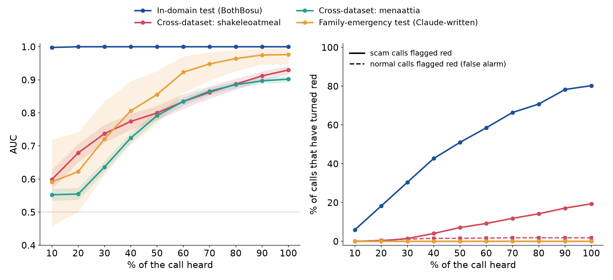
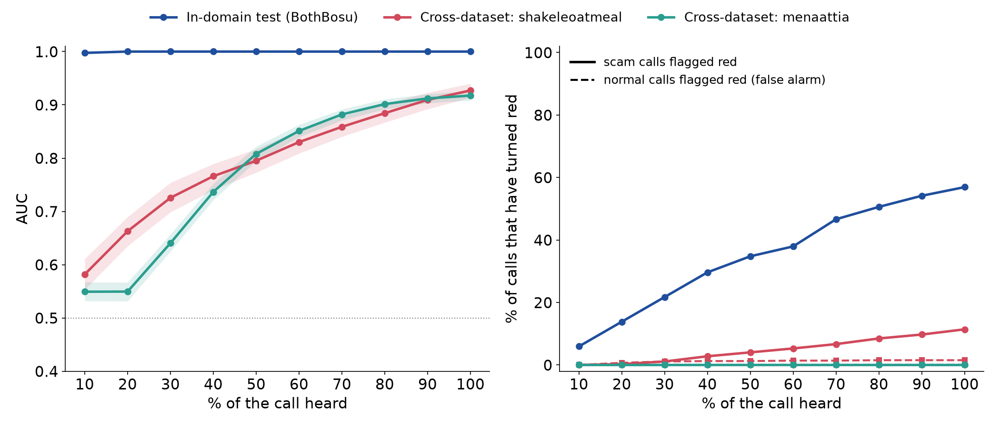

# Liveline Stage 2: scam-tactic text model (version 2.1, shipped)

Version 2.1 keeps version 2's model weights and changes only the calibration layer, which turns the model's raw score into a probability. It was done by `calibrate_v21.py`; numbers are in `results_v21.json`. Version 2's full report follows below, unchanged, and its files are in `v2/`.

**Why.** Version 2 ranked calls well (family-emergency test AUC 0.976) but no family scam ever turned yellow or red: its calibration was fit on shakeleoatmeal and the family scenarios pooled, and shakeleoatmeal's real refund and Social Security calls sound like scams (median p 0.60 for its normal calls), which made the calibrator cautious everywhere.

**What changed.** Two things. To be clear about the order: version 2's failure to raise any alarm on the family test set is what prompted this change, so the family test set is no longer a clean holdout for version 2.1, and its family numbers are development results, somewhat optimistic. The new calibration itself is fit only on validation data:
1. The score is measured from an empty transcript's score (u = z - z0) and confidence may grow with the words heard: p = 1 / (1 + exp(-(a*u + d*u*ln(1+n) + b))), n = caller words so far. No words means no evidence, and length alone cannot move the score.
2. It is calibrated on the held-out family validation scenarios only, because Liveline screens calls that claim to be family.

We also fit the length-aware formula on the pooled validation data ("v21_pooled"). It changed almost nothing (d = 0.03), which is how we learned that pooling, not call length, was the problem.

**Calibration quality** (cross-fitted Brier score on validation, lower is better):

| Recipe | Family val, 10-30% of call | Family val, 80-100% | shakeleoatmeal val, 80-100% |
|---|---|---|---|
| v2 (pooled, z only) | 0.263 | 0.187 | 0.218 |
| v21_pooled | 0.264 | 0.188 | 0.217 |
| **v21_family (shipped)** | **0.251** | **0.120** | 0.438 |

**Test results with each recipe** (each with its own thresholds, same rule as version 2):

| Test set | Recipe | AUC (full call) | Scams ever yellow | Scams ever red | Normal ever yellow | Normal ever red |
|---|---|---|---|---|---|---|
| Family-emergency test (80, AI-written) | v2 | 0.976 | 0% | 0% | 0% | 0% |
| | **v21_family** | **0.978** | **100%** | **87.5%** | 42.5% | 7.5% |
| Family hard negatives (25 of the 40 normal calls) | v21_family | | | | 36% | 8% |
| shakeleoatmeal train+test (1,439) | v2 | 0.930 | 62.3% | 19.3% | 8.5% | 1.8% |
| | v21_family | 0.884 | 100% | 99.9% | 98.3% | 83.9% |
| menaattia, all 4,000 | v2 | 0.902 | 0.2% | 0% | 0% | 0% |
| | v21_family | 0.900 | 47.0% | 5.7% | 5.3% | 0.1% |
| YouTube scambait transcripts (20, all scams) | v2 | | 0% | 0% | | |
| | v21_family | | 95% | 65% | | |

What this says:
- On the kind of call Liveline is for, the shipped calibration turns the model's good ranking into alarms: every family scam reached yellow and 87.5% reached red. The price is false alarms: 42.5% of real family calls reached yellow ("check first") and 7.5% reached red at some point.
- The calibration is specific to family-style calls. On shakeleoatmeal, where real calls are about refunds and Social Security, it flags nearly everything (83.9% of real calls go red), and its AUC there drops from 0.930 to 0.884 because the length term is not monotonic across calls of different lengths. The YouTube detection rate rises for the same reason, so it is not evidence on its own.
- The app does not use these Stage 2 thresholds. It combines the language score with the voice score and uses cut-offs tuned on validation calls for the combined probability (see ../RESULTS.md, Fusion).
- JavaScript parity for the new formula: max |p_js - p_python| = 4.4e-16 over 1,590 cases (`parity_v21.js`, `parity_v21.json`).
- All family-emergency calls, in training, validation and test, were written by AI. These numbers show the model learned what those calls look like, not that it catches real grandparent scams.

To rebuild version 2.1 from scratch: `train.py` (writes the version 2 model.json), then `calibrate_v21.py`, then `node parity_v21.js`, then `../.venv/bin/python ../embed_model.py` to copy the model into the app.

---

# Version 2 report (kept as written)

Stage 2 reads what the caller says and scores how much it sounds like a scam. It is a small TF-IDF plus logistic regression model that runs in plain browser JavaScript (`stage2_model.js`, no libraries) and returns a calibrated probability, a log-likelihood ratio for the Bayesian fusion step, a green / yellow / red band, and rule-based tactic tags for the plain-language "why".

Version 2 adds family-emergency ("grandparent") calls, which no public dataset has, and tries a tactic-count input. Version 1 (public data only) is kept at the end of this file and in `v1/`. Every number below is filled in by `make_report.py` from files written by `audit.py`, `train.py` and `parity_test.js`. Nothing was tuned on a test set.

> **Read this before quoting any family-call number.** All family-emergency calls (training, validation and test) were written by AI for this project. The app's demo calls were also written with AI help. So the family test result says the model learned what an AI model thinks these calls sound like, not that it catches real grandparent scams, and the demo-call scores below are a sanity check, not evidence.

## The short version

- **Family-emergency calls:** on the held-out family test batch (different writers, scenarios and names), AUC went from 0.814 [0.705, 0.905] with version 1 to **0.976 [0.946, 0.995]** with version 2; EER 0.263 [0.163, 0.362] to 0.125 [0.038, 0.188]. Scams that turned red at any point: 0.0% to 0.0%; yellow: 0.0% to 0.0%. Normal family calls that ever turned red: 0.0% to 0.0%; yellow: 0.0% to 0.0%.
- **But the alarm still never fires on family calls.** Family scams get a median p of 0.578 against 0.343 for normal family calls, so they rank well, but the shipped thresholds (yellow 0.78, red 0.843) come from the strictest validation source, shakeleoatmeal, and sit above every family test call. The held-out family scenarios alone would have put yellow at 0.4 and red at 0.501. Changing the threshold rule now, after seeing test results, would be tuning on test, so it was not done; it is the first thing to decide for version 3.
- **The tactic-count input did not help:** on validation, variant D scored at or below variant A at every C and family weight.
- **Public test sets, before and after:** shakeleoatmeal AUC 0.927 to 0.930, menaattia 0.917 to 0.902, in-domain 1.000 to 1.000. menaattia got slightly worse (0.917 [0.909, 0.925] to 0.902 [0.893, 0.911]); shakeleoatmeal is unchanged within its intervals. Full table below.
- **Chosen model:** A_word12, C = 1.0, family rows weighted 1x. Thresholds: yellow 0.78, red 0.843 (version 1: 0.76, 0.873).
- **Demo calls:** clone 0.62, real 0.31, unsure 0.43, medicare 0.67 at most (yellow starts at 0.78). Not evidence either way (see the box above).
- **JavaScript parity:** max |p_js - p_sklearn| = 6.7e-16 on 5148 cases, PASS. `model.json` is 152,867 bytes.

## Rerun everything

```bash
cd research/stage2
../.venv/bin/python fetch_data.py    # public datasets at pinned commits -> research/data/stage2/
# family calls: research/data/stage2/family/{train,test}/batch_*.txt (written once by AI; checked with family_check.py)
../.venv/bin/python audit.py         # leakage audit -> audit.json, audit_output.txt
../.venv/bin/python train.py         # about 3 min -> model.json, results.json, test_scores.csv, streaming_curve.png
node parity_test.js                  # JavaScript vs scikit-learn -> parity_result.json
../.venv/bin/python make_report.py   # this file
```

Seed 0. Python 3.12.13, scikit-learn 1.9.1, numpy 2.5.4, scipy 1.18.1, node v25.9.0.

## Before and after (version 1 vs version 2)

Version 1 numbers come from `v1/results.json`; version 1 on the family sets was scored by running `v1/model.json` through the same math as the JavaScript (self-check: it reproduces version 1's menaattia test AUC, 0.9099 vs 0.9099). Each version uses its own thresholds.

| Set (v1 / v2) | AUC | EER | Scams ever yellow | Scams ever red | Normal ever yellow (false alarm) | Normal ever red (false alarm) |
|---|---|---|---|---|---|---|
| In-domain test (BothBosu, de-duplicated) | 1.000 / 1.000 | 0.000 / 0.000 | 92.5% / 96.4% | 56.9% / 80.2% | 0.0% / 0.0% | 0.0% / 0.0% |
| In-domain test, strict de-dup | 1.000 / 1.000 | 0.000 / 0.000 | 92.5% / 96.4% | 56.9% / 80.2% | 0.0% / 0.0% | 0.0% / 0.0% |
| shakeleoatmeal test split | 0.924 / 0.920 | 0.139 / 0.156 | 61.1% / 64.4% | 12.2% / 18.9% | 8.9% / 8.9% | 1.1% / 1.1% |
| shakeleoatmeal train+test | 0.927 / 0.930 | 0.140 / 0.140 | 59.5% / 62.3% | 11.4% / 19.3% | 7.8% / 8.5% | 1.5% / 1.8% |
| menaattia test split | 0.910 / 0.896 | 0.180 / 0.200 | 0.2% / 0.2% | 0.0% / 0.0% | 0.0% / 0.0% | 0.0% / 0.0% |
| menaattia train+test | 0.917 / 0.902 | 0.168 / 0.185 | 0.4% / 0.1% | 0.0% / 0.0% | 0.0% / 0.0% | 0.0% / 0.0% |
| YouTube scambait transcripts (scams only) | n/a / n/a | n/a / n/a | 0.0% / 0.0% | 0.0% / 0.0% | n/a / n/a | n/a / n/a |
| Family-emergency TEST batch | 0.814 / 0.976 | 0.263 / 0.125 | 0.0% / 0.0% | 0.0% / 0.0% | 0.0% / 0.0% | 0.0% / 0.0% |

Confidence intervals for every version 2 number are in the results tables below; version 1's are in the appendix.

## The family-emergency calls (new in version 2)

**Who wrote them.** Six separate AI writing sessions, each writing the calls directly (no generator scripts) in the same `caller:` / `receiver:` format. Four wrote the TRAIN batch (each 30 scam + 30 normal from its own 3 + 3 scenarios); two wrote the TEST batch (each 20 + 20) from a different scenario list and a different set of names. Every writer wrote both classes, so writing style cannot stand in for the label. Writers were told to read no other file, so the test writers never saw the training calls and no writer saw the app or its demo calls. The scenario lists and writing rules were written by the agent running this study, who *had* read the demo calls earlier for the version 1 sanity run, so the themes overlap with the demo by design (the demo's lead scenario is a grandparent bail scam). The coordinator asked for both batches written in order; they were written in parallel instead, with the test writers isolated from the training files, which serves the same purpose.

**Rules given to writers (both classes).** Same relationship words and openings, same mix of tones, 3 to 14 caller turns split evenly short / medium / long. Scams: varied payment (gift cards, wire, cash courier or overnight mail, crypto ATM, Zelle / Venmo / Cash App), secrecy, urgency, excuses for sounding different, a second person taking over, about a quarter with a subtle ask. Normal calls: about 1 in 10 innocently mention sounding different, and the hard negatives mention money, trouble, a hospital, a new number or a bank innocently.

**Sizes.** Training 160 (from 16 scenarios), validation 80 (8 held-out scenarios, chosen before any model saw the data), test 80 (40 scam / 40 normal, 16 scenarios).

| Scenario | Class | Batch | What it is |
|---|---|---|---|
| TS01 | scam | train | arrested after a car accident, bail, 'lawyer' takes over |
| TS02 | scam | train | hospital after a crash, pay before treatment |
| TS03 | scam | validation | stuck abroad, passport and wallet stolen |
| TS04 | scam | train | drugs in a friend's car, bail, don't tell parents |
| TS05 | scam | train | 'officer' says DUI custody, cash courier |
| TS06 | scam | validation | caused an accident, settle quietly to avoid lawsuit |
| TS07 | scam | train | adult child on work trip, lost wallet, voice sounds different, payment app |
| TS08 | scam | train | bar fight, lawyer retainer in gift cards |
| TS09 | scam | validation | owes dangerous people, crypto ATM |
| TS10 | scam | train | 'ER doctor' wants surgery deposit by wire |
| TS11 | scam | validation | SUBTLE: chit-chat then small ask to a friend's account |
| TS12 | scam | train | 'bail bondsman' follow-up, cash in a box, gag order |
| TN01 | normal | train | plan a visit or airport ride |
| TN02 | normal | train | check-in after a doctor visit |
| TN03 | normal | validation | new phone number, nothing asked |
| TN04 | normal | train | birthday call or party planning |
| TN05 | normal | train | HARD: paying back a small loan by Venmo/check |
| TN06 | normal | validation | HARD: 'did you get the check Mom mailed?' |
| TN07 | normal | train | HARD: car broke down, parent already coming |
| TN08 | normal | train | HARD: chip in on a group gift, no pressure |
| TN09 | normal | validation | HARD: real doctor's office reminder |
| TN10 | normal | train | HARD: real bank fraud alert, 'call the number on your card' |
| TN11 | normal | validation | good news, past trouble resolved |
| TN12 | normal | train | HARD: ride to the store, paying back for groceries |
| XS01 | scam | test | hurt on a trip, clinic won't discharge until paid, Cash App/wire |
| XS02 | scam | test | relative 'held' over a debt, stay on the line and pay |
| XS03 | scam | test | arrested at protest/concert, bail in prepaid cards |
| XS04 | scam | test | abroad, customs found something, fine by wire/crypto, 'been crying' |
| XS05 | scam | test | in-law says your child crashed, tow + co-pay, child's phone broken |
| XS06 | scam | test | 'insurance adjuster' private settlement, cash courier |
| XS07 | scam | test | SUBTLE: catch-up then rent 'loan', keep from parents, gift cards |
| XS08 | scam | test | new number, jail on old traffic warrant, gift cards |
| XN01 | normal | test | asks for a family recipe |
| XN02 | normal | test | pharmacy pickup reminder, offers a ride |
| XN03 | normal | test | HARD: speeding ticket already paid, no ask |
| XN04 | normal | test | HARD: real pharmacy, prescription ready, copay at pickup |
| XN05 | normal | test | HARD: open ask to chip in to a family trip fund |
| XN06 | normal | test | HARD: credit union, new card, call number on back |
| XN07 | normal | test | HARD: lost wallet last week, already handled |
| XN08 | normal | test | HARD: calling from the hospital with happy news |

**Overlap check.** Word 5-gram Jaccard from each test call to its nearest train-batch call: max 0.039, median 0.006; 0 of 80 at 0.3 or more (near-copy level is 0.5). Inside the train batch the nearest-neighbor max is 0.036. No copying, by this measure.

**Leaks in the family data.** Family scam callers talk longer: median caller words 178 vs 130, and caller word count alone gives AUC 0.679 (all family calls). The receiver says "scam" or "fraud" in 1.3% of scams and 1.9% of normal calls, so that leak is absent (and receiver lines are ignored anyway). Writer names: the TRAIN-batch names are in the name list that becomes `name`; the TEST names are deliberately not, so to the model they are unknown words, as a real caller's name would be.

## Model choice (validation only)

Training pool: BothBosu (de-duplicated, as in version 1) plus the family training scenarios. Two variants: **A**, TF-IDF + logistic regression with Platt calibration (version 1's model), and **D**, the same plus the number of distinct rule-tagged tactics as a second input to the calibration layer. D's tactic count enters only the small calibration model fit on validation data, because on BothBosu the rules alone already reach AUC 0.98, and putting the count into the big model would let it lean on that.

Selection rule, fixed before the run: over every (variant, C, family weight): mean over the two validation sources (shakeleoatmeal/validation and the held-out family scenarios) of the AUC averaged over 10%..100% prefixes, using cross-fitted calibrated probabilities; settings within 0.005 of the best are tied and go to the simplest (no tactic count, then lower family weight, then smallest C).

| Variant | C | Family weight | shakeleoatmeal val AUC (full) | shakeleoatmeal val AUC (mean over prefixes) | Family val AUC (full) | Family val AUC (mean over prefixes) | Score |
|---|---|---|---|---|---|---|---|
| A_word12 | 0.1 | 1 | 0.909 | 0.779 | 0.881 | 0.773 | 0.7759 |
| D_word12_plus_tactic_count | 0.1 | 1 | 0.883 | 0.745 | 0.879 | 0.724 | 0.7346 |
| A_word12 | 0.3 | 1 | 0.903 | 0.779 | 0.896 | 0.783 | 0.7812 |
| D_word12_plus_tactic_count | 0.3 | 1 | 0.900 | 0.769 | 0.906 | 0.760 | 0.7646 |
| A_word12 | 1.0 | 1 | 0.893 | 0.776 | 0.906 | 0.794 | 0.7849 |
| D_word12_plus_tactic_count | 1.0 | 1 | 0.897 | 0.779 | 0.916 | 0.785 | 0.7818 |
| A_word12 | 3.0 | 1 | 0.886 | 0.771 | 0.913 | 0.796 | 0.7838 |
| D_word12_plus_tactic_count | 3.0 | 1 | 0.886 | 0.774 | 0.920 | 0.789 | 0.7811 |
| A_word12 | 0.1 | 3 | 0.896 | 0.774 | 0.900 | 0.788 | 0.7810 |
| D_word12_plus_tactic_count | 0.1 | 3 | 0.899 | 0.774 | 0.917 | 0.779 | 0.7764 |
| A_word12 | 0.3 | 3 | 0.890 | 0.774 | 0.911 | 0.794 | 0.7838 |
| D_word12_plus_tactic_count | 0.3 | 3 | 0.890 | 0.775 | 0.916 | 0.786 | 0.7810 |
| A_word12 | 1.0 | 3 | 0.885 | 0.773 | 0.921 | 0.801 | 0.7872 |
| D_word12_plus_tactic_count | 1.0 | 3 | 0.876 | 0.771 | 0.917 | 0.799 | 0.7847 |
| A_word12 | 3.0 | 3 | 0.883 | 0.773 | 0.927 | 0.804 | 0.7888 |
| D_word12_plus_tactic_count | 3.0 | 3 | 0.869 | 0.768 | 0.913 | 0.800 | 0.7840 |

**Chosen: A_word12, C = 1.0, family weight 1.**

Text-choice ablations on validation (raw model score AUC, full call / mean over prefixes):

| Input | shakeleoatmeal val | Family val |
|---|---|---|
| chosen (caller words, names/greetings neutralized) | 0.916 / 0.789 | 0.944 / 0.848 |
| caller words, names/greetings NOT neutralized | 0.914 / 0.793 | 0.946 / 0.845 |
| both speakers (receiver lines included) | 0.906 / 0.783 | 0.958 / 0.846 |

## Calibration, likelihood ratio, thresholds

Calibration layer fit on shakeleoatmeal/validation + held-out family scenarios, 10%..100% prefixes, equal weight per source: `p = 1 / (1 + exp(-(a z + c k + b)))` with a = 0.591943, c = 0.0 (tactic count k), b = -0.0535122; `llr = logit(p) - logit(prior)`, prior = 0.5007. Cross-fitted Brier / ECE: shakeleoatmeal val 0.224 / 0.128, family val 0.220 / 0.176; Brier on training-pool out-of-fold scores 0.048.

Threshold rule: smallest p (3 decimals) such that at most 10% (yellow) / 2% (red) of non-scam calls EVER reach it at any 2% checkpoint; the strictest of training-pool out-of-fold, shakeleoatmeal/validation and the held-out family scenarios.

| Band | Training pool OOF | shakeleoatmeal val | Family val | Shipped (strictest) | Version 1 |
|---|---|---|---|---|---|
| yellow | 0.427 | 0.78 | 0.4 | 0.78 | 0.76 |
| red | 0.467 | 0.843 | 0.501 | 0.843 | 0.873 |

Calibration on the test sets (full call / pooled over prefixes):

| Set | Brier | ECE | Median p, scams | Median p, normal |
|---|---|---|---|---|
| In-domain test (BothBosu, de-duplicated) | 0.021 / 0.034 | 0.136 / 0.162 | 0.868 | 0.122 |
| In-domain test, strict de-dup | 0.022 / 0.035 | 0.138 / 0.163 | 0.868 | 0.126 |
| shakeleoatmeal test split | 0.210 / 0.227 | 0.252 / 0.156 | 0.796 | 0.605 |
| shakeleoatmeal train+test | 0.209 / 0.223 | 0.243 / 0.151 | 0.790 | 0.599 |
| menaattia test split | 0.199 / 0.226 | 0.213 / 0.150 | 0.451 | 0.295 |
| menaattia train+test | 0.200 / 0.226 | 0.217 / 0.154 | 0.451 | 0.297 |
| Family-emergency TEST batch (AI-written) | 0.159 / 0.207 | 0.319 / 0.180 | 0.578 | 0.343 |
| shakeleoatmeal validation (tuning, reference) | 0.211 / 0.222 | 0.237 / 0.140 | 0.788 | 0.605 |
| Held-out family scenarios (tuning, reference) | 0.180 / 0.214 | 0.254 / 0.142 | 0.506 | 0.307 |

## Results (version 2)

95% stratified bootstrap intervals (2,000 resamples; 1,000 for per-fraction AUCs; 500 for the two reference validation rows).

| Set | Calls (scam / normal) | AUC | EER | Accuracy at p = 0.5 | Rules-only baseline AUC |
|---|---|---|---|---|---|
| In-domain test (BothBosu, de-duplicated) | 636 (253 / 383) | 1.000 [1.000, 1.000] | 0.000 [0.000, 0.000] | 1.000 [1.000, 1.000] | 0.979 [0.969, 0.988] |
| In-domain test, strict de-dup | 598 (253 / 345) | 1.000 [1.000, 1.000] | 0.000 [0.000, 0.000] | 1.000 [1.000, 1.000] | 0.977 [0.966, 0.987] |
| shakeleoatmeal test split | 180 (90 / 90) | 0.920 [0.881, 0.954] | 0.156 [0.100, 0.217] | 0.594 [0.556, 0.633] | 0.798 [0.738, 0.852] |
| shakeleoatmeal train+test | 1439 (719 / 720) | 0.930 [0.916, 0.942] | 0.140 [0.123, 0.159] | 0.598 [0.582, 0.612] | 0.751 [0.729, 0.774] |
| menaattia test split | 800 (400 / 400) | 0.896 [0.874, 0.918] | 0.200 [0.171, 0.225] | 0.659 [0.636, 0.682] | 0.783 [0.757, 0.807] |
| menaattia train+test | 4000 (2000 / 2000) | 0.902 [0.893, 0.911] | 0.185 [0.173, 0.197] | 0.648 [0.638, 0.659] | 0.800 [0.789, 0.810] |
| YouTube scambait transcripts (scams only) | 20 (20 / 0) | n/a | n/a | n/a | n/a |
| Family-emergency TEST batch (AI-written) | 80 (40 / 40) | 0.976 [0.946, 0.995] | 0.125 [0.038, 0.188] | 0.875 [0.800, 0.938] | 0.887 [0.812, 0.951] |
| shakeleoatmeal validation (tuning, reference) | 361 (181 / 180) | 0.916 [0.887, 0.941] | 0.152 [0.114, 0.194] | 0.604 [0.576, 0.637] | 0.771 [0.724, 0.815] |
| Held-out family scenarios (tuning, reference) | 80 (40 / 40) | 0.944 [0.898, 0.984] | 0.125 [0.050, 0.232] | 0.762 [0.688, 0.838] | 0.854 [0.776, 0.921] |

**Yellow (p >= 0.78)**

| Set | Scams caught (end) | Scams caught (any time) | False alarms (end) | False alarms (any time) | Accuracy (end) |
|---|---|---|---|---|---|
| In-domain test (BothBosu, de-duplicated) | 94.1% [90.9%, 96.8%] | 96.4% [94.1%, 98.4%] | 0.0% [0.0%, 0.0%] | 0.0% [0.0%, 0.0%] | 97.6% [96.4%, 98.7%] |
| In-domain test, strict de-dup | 94.1% [90.9%, 96.8%] | 96.4% [94.1%, 98.4%] | 0.0% [0.0%, 0.0%] | 0.0% [0.0%, 0.0%] | 97.5% [96.2%, 98.7%] |
| shakeleoatmeal test split | 58.9% [48.9%, 68.9%] | 64.4% [54.4%, 74.4%] | 2.2% [0.0%, 5.6%] | 8.9% [3.3%, 14.4%] | 78.3% [73.3%, 83.9%] |
| shakeleoatmeal train+test | 55.4% [51.7%, 58.8%] | 62.3% [58.6%, 65.6%] | 3.2% [1.9%, 4.6%] | 8.5% [6.5%, 10.6%] | 76.1% [74.1%, 78.0%] |
| menaattia test split | 0.0% [0.0%, 0.0%] | 0.2% [0.0%, 0.8%] | 0.0% [0.0%, 0.0%] | 0.0% [0.0%, 0.0%] | 50.0% [50.0%, 50.0%] |
| menaattia train+test | 0.0% [0.0%, 0.0%] | 0.1% [0.0%, 0.4%] | 0.0% [0.0%, 0.0%] | 0.0% [0.0%, 0.0%] | 50.0% [50.0%, 50.0%] |
| YouTube scambait transcripts (scams only) | 0.0% [0.0%, 0.0%] | 0.0% [0.0%, 0.0%] | n/a | n/a | n/a |
| Family-emergency TEST batch (AI-written) | 0.0% [0.0%, 0.0%] | 0.0% [0.0%, 0.0%] | 0.0% [0.0%, 0.0%] | 0.0% [0.0%, 0.0%] | 50.0% [50.0%, 50.0%] |
| shakeleoatmeal validation (tuning, reference) | 54.7% [48.1%, 61.9%] | 60.2% [53.0%, 66.9%] | 3.9% [1.1%, 7.2%] | 10.0% [6.1%, 13.9%] | 75.3% [71.3%, 79.2%] |
| Held-out family scenarios (tuning, reference) | 0.0% [0.0%, 0.0%] | 0.0% [0.0%, 0.0%] | 0.0% [0.0%, 0.0%] | 0.0% [0.0%, 0.0%] | 50.0% [50.0%, 50.0%] |

**Red (p >= 0.843)**

| Set | Scams caught (end) | Scams caught (any time) | False alarms (end) | False alarms (any time) | Accuracy (end) |
|---|---|---|---|---|---|
| In-domain test (BothBosu, de-duplicated) | 69.6% [64.0%, 75.1%] | 80.2% [75.1%, 84.6%] | 0.0% [0.0%, 0.0%] | 0.0% [0.0%, 0.0%] | 87.9% [85.7%, 90.1%] |
| In-domain test, strict de-dup | 69.6% [64.0%, 75.1%] | 80.2% [75.1%, 85.0%] | 0.0% [0.0%, 0.0%] | 0.0% [0.0%, 0.0%] | 87.1% [84.8%, 89.5%] |
| shakeleoatmeal test split | 10.0% [4.4%, 16.7%] | 18.9% [11.1%, 26.7%] | 0.0% [0.0%, 0.0%] | 1.1% [0.0%, 3.3%] | 55.0% [52.2%, 58.3%] |
| shakeleoatmeal train+test | 14.7% [12.2%, 17.4%] | 19.3% [16.6%, 22.1%] | 0.1% [0.0%, 0.4%] | 1.8% [1.0%, 2.9%] | 57.3% [56.1%, 58.7%] |
| menaattia test split | 0.0% [0.0%, 0.0%] | 0.0% [0.0%, 0.0%] | 0.0% [0.0%, 0.0%] | 0.0% [0.0%, 0.0%] | 50.0% [50.0%, 50.0%] |
| menaattia train+test | 0.0% [0.0%, 0.0%] | 0.0% [0.0%, 0.0%] | 0.0% [0.0%, 0.0%] | 0.0% [0.0%, 0.0%] | 50.0% [50.0%, 50.0%] |
| YouTube scambait transcripts (scams only) | 0.0% [0.0%, 0.0%] | 0.0% [0.0%, 0.0%] | n/a | n/a | n/a |
| Family-emergency TEST batch (AI-written) | 0.0% [0.0%, 0.0%] | 0.0% [0.0%, 0.0%] | 0.0% [0.0%, 0.0%] | 0.0% [0.0%, 0.0%] | 50.0% [50.0%, 50.0%] |
| shakeleoatmeal validation (tuning, reference) | 14.9% [10.5%, 19.9%] | 20.4% [14.9%, 26.8%] | 0.0% [0.0%, 0.0%] | 1.1% [0.0%, 2.8%] | 57.3% [54.8%, 59.8%] |
| Held-out family scenarios (tuning, reference) | 0.0% [0.0%, 0.0%] | 0.0% [0.0%, 0.0%] | 0.0% [0.0%, 0.0%] | 0.0% [0.0%, 0.0%] | 50.0% [50.0%, 50.0%] |

### Family test batch by scenario (hard negatives marked HARD)

| Scenario | What it is | Calls | Yellow or red (end) | Yellow or red (any time) | Red (end) | Red (any time) |
|---|---|---|---|---|---|---|
| XN01 | asks for a family recipe | 5 | 0.0% | 0.0% | 0.0% | 0.0% |
| XN02 | pharmacy pickup reminder, offers a ride | 5 | 0.0% | 0.0% | 0.0% | 0.0% |
| XN03 | HARD: speeding ticket already paid, no ask | 5 | 0.0% | 0.0% | 0.0% | 0.0% |
| XN04 | HARD: real pharmacy, prescription ready, copay at pickup | 5 | 0.0% | 0.0% | 0.0% | 0.0% |
| XN05 | HARD: open ask to chip in to a family trip fund | 5 | 0.0% | 0.0% | 0.0% | 0.0% |
| XN06 | HARD: credit union, new card, call number on back | 5 | 0.0% | 0.0% | 0.0% | 0.0% |
| XN07 | HARD: lost wallet last week, already handled | 5 | 0.0% | 0.0% | 0.0% | 0.0% |
| XN08 | HARD: calling from the hospital with happy news | 5 | 0.0% | 0.0% | 0.0% | 0.0% |
| XS01 | hurt on a trip, clinic won't discharge until paid, Cash App/wire | 5 | 0.0% | 0.0% | 0.0% | 0.0% |
| XS02 | relative 'held' over a debt, stay on the line and pay | 5 | 0.0% | 0.0% | 0.0% | 0.0% |
| XS03 | arrested at protest/concert, bail in prepaid cards | 5 | 0.0% | 0.0% | 0.0% | 0.0% |
| XS04 | abroad, customs found something, fine by wire/crypto, 'been crying' | 5 | 0.0% | 0.0% | 0.0% | 0.0% |
| XS05 | in-law says your child crashed, tow + co-pay, child's phone broken | 5 | 0.0% | 0.0% | 0.0% | 0.0% |
| XS06 | 'insurance adjuster' private settlement, cash courier | 5 | 0.0% | 0.0% | 0.0% | 0.0% |
| XS07 | SUBTLE: catch-up then rent 'loan', keep from parents, gift cards | 5 | 0.0% | 0.0% | 0.0% | 0.0% |
| XS08 | new number, jail on old traffic warrant, gift cards | 5 | 0.0% | 0.0% | 0.0% | 0.0% |

Across the 30 hard-negative test calls: ever yellow or red 0.0%, ever red 0.0%.

### Streaming

Each call is cut at 10%, 20%, ... 100% of its words (both speakers count toward the length); the model scores the caller's words in that prefix.



| % heard | AUC in-domain | AUC shakeleoatmeal | AUC menaattia | AUC family test | scams yellow / red by now (in-domain) | scams yellow / red by now (shakeleoatmeal) | scams yellow / red by now (menaattia) | scams yellow / red by now (family test) | normal yellow / red by now (in-domain) | normal yellow / red by now (shakeleoatmeal) | normal yellow / red by now (menaattia) | normal yellow / red by now (family test) |
|---|---|---|---|---|---|---|---|---|---|---|---|---|
| 10% | 0.998 [0.996, 0.999] | 0.599 [0.570, 0.628] | 0.553 [0.535, 0.570] | 0.591 [0.458, 0.719] | 19.4% / 5.9% | 0.4% / 0.0% | 0.0% / 0.0% | 0.0% / 0.0% | 0.0% / 0.0% | 1.2% / 0.0% | 0.0% / 0.0% | 0.0% / 0.0% |
| 20% | 1.000 [1.000, 1.000] | 0.679 [0.651, 0.706] | 0.555 [0.537, 0.573] | 0.623 [0.501, 0.742] | 41.9% / 18.2% | 4.2% / 0.3% | 0.0% / 0.0% | 0.0% / 0.0% | 0.0% / 0.0% | 2.5% / 0.6% | 0.0% / 0.0% | 0.0% / 0.0% |
| 30% | 1.000 [1.000, 1.000] | 0.737 [0.710, 0.764] | 0.636 [0.621, 0.653] | 0.721 [0.612, 0.834] | 59.7% / 30.4% | 13.9% / 1.4% | 0.0% / 0.0% | 0.0% / 0.0% | 0.0% / 0.0% | 4.2% / 1.1% | 0.0% / 0.0% | 0.0% / 0.0% |
| 40% | 1.000 [1.000, 1.000] | 0.774 [0.749, 0.798] | 0.724 [0.709, 0.740] | 0.806 [0.704, 0.896] | 70.8% / 42.7% | 24.1% / 4.0% | 0.1% / 0.0% | 0.0% / 0.0% | 0.0% / 0.0% | 5.4% / 1.5% | 0.0% / 0.0% | 0.0% / 0.0% |
| 50% | 1.000 [1.000, 1.000] | 0.800 [0.778, 0.821] | 0.792 [0.778, 0.807] | 0.856 [0.767, 0.927] | 82.2% / 51.0% | 30.5% / 7.1% | 0.1% / 0.0% | 0.0% / 0.0% | 0.0% / 0.0% | 6.9% / 1.5% | 0.0% / 0.0% | 0.0% / 0.0% |
| 60% | 1.000 [1.000, 1.000] | 0.834 [0.813, 0.857] | 0.835 [0.822, 0.847] | 0.923 [0.861, 0.971] | 87.7% / 58.5% | 38.4% / 9.2% | 0.1% / 0.0% | 0.0% / 0.0% | 0.0% / 0.0% | 7.4% / 1.7% | 0.0% / 0.0% | 0.0% / 0.0% |
| 70% | 1.000 [1.000, 1.000] | 0.862 [0.843, 0.881] | 0.866 [0.854, 0.876] | 0.948 [0.898, 0.983] | 90.5% / 66.4% | 46.2% / 11.8% | 0.1% / 0.0% | 0.0% / 0.0% | 0.0% / 0.0% | 7.9% / 1.8% | 0.0% / 0.0% | 0.0% / 0.0% |
| 80% | 1.000 [1.000, 1.000] | 0.887 [0.870, 0.904] | 0.885 [0.875, 0.895] | 0.964 [0.927, 0.990] | 92.9% / 70.8% | 53.4% / 14.2% | 0.1% / 0.0% | 0.0% / 0.0% | 0.0% / 0.0% | 8.3% / 1.8% | 0.0% / 0.0% | 0.0% / 0.0% |
| 90% | 1.000 [1.000, 1.000] | 0.912 [0.896, 0.926] | 0.897 [0.888, 0.906] | 0.975 [0.946, 0.994] | 95.3% / 78.3% | 58.6% / 17.1% | 0.1% / 0.0% | 0.0% / 0.0% | 0.0% / 0.0% | 8.5% / 1.8% | 0.0% / 0.0% | 0.0% / 0.0% |
| 100% | 1.000 [1.000, 1.000] | 0.930 [0.917, 0.942] | 0.902 [0.892, 0.911] | 0.976 [0.946, 0.996] | 96.4% / 80.2% | 62.3% / 19.3% | 0.1% / 0.0% | 0.0% / 0.0% | 0.0% / 0.0% | 8.5% / 1.8% | 0.0% / 0.0% | 0.0% / 0.0% |

Time to first yellow / red for scam calls ("never" when fewer than half ever got there):

| Set | Ever yellow | Median % heard to yellow [CI] | Median, among those that got there | Ever red | Median % heard to red [CI] | Median, among those that got there |
|---|---|---|---|---|---|---|
| In-domain test (BothBosu, de-duplicated) | 96.4% | 26% [22%, 28%] | 24% | 80.2% | 50% [42%, 58%] | 38% |
| In-domain test, strict de-dup | 96.4% | 26% [22%, 28%] | 24% | 80.2% | 50% [42%, 58%] | 38% |
| shakeleoatmeal test split | 64.4% | 72% [56%, 89%] | 46% | 18.9% | never [never, never] | 52% |
| shakeleoatmeal train+test | 62.3% | 76% [72%, 82%] | 52% | 19.3% | never [never, never] | 62% |
| menaattia test split | 0.2% | never [never, never] | 42% | 0.0% | never [never, never] | n/a |
| menaattia train+test | 0.1% | never [never, never] | 42% | 0.0% | never [never, never] | n/a |
| YouTube scambait transcripts (scams only) | 0.0% | never [never, never] | n/a | 0.0% | never [never, never] | n/a |
| Family-emergency TEST batch (AI-written) | 0.0% | never [never, never] | n/a | 0.0% | never [never, never] | n/a |
| shakeleoatmeal validation (tuning, reference) | 60.2% | 84% [70%, 90%] | 54% | 20.4% | never [never, never] | 64% |
| Held-out family scenarios (tuning, reference) | 0.0% | never [never, never] | n/a | 0.0% | never [never, never] | n/a |

## Tactic tags (rule-based, not machine learning)

Same hand-written rules as version 1. In version 2 the *count* of distinct tags is an input to the calibration layer only if variant D was chosen (c = 0.0). Fire rates on the caller's words (scam / normal):

| Rule | Training pool | shakeleoatmeal | menaattia | Family test |
|---|---|---|---|---|
| Rushing you or saying it is urgent | 56.1% / 11.6% | 53.4% / 15.3% | 10.5% / 0.3% | 32.5% / 22.5% |
| Telling you to keep it secret | 2.1% / 0.2% | 0.1% / 0.0% | 0.1% / 0.0% | 27.5% / 5.0% |
| Asking for gift cards | 26.3% / 1.2% | 0.6% / 0.3% | 2.2% / 0.0% | 40.0% / 0.0% |
| Asking for a wire transfer or money app | 5.7% / 0.7% | 1.1% / 0.1% | 1.8% / 0.0% | 25.0% / 0.0% |
| Asking for Bitcoin or crypto | 0.3% / 0.0% | 0.0% / 0.0% | 1.0% / 0.0% | 12.5% / 0.0% |
| Asking you to send money or pay a fee | 24.5% / 0.1% | 1.4% / 0.1% | 6.9% / 0.0% | 10.0% / 0.0% |
| Talking about arrest, bail, or legal trouble | 12.9% / 0.4% | 2.6% / 0.0% | 5.5% / 0.1% | 37.5% / 0.0% |
| Claiming to be the government, your bank, or a big company | 69.8% / 6.9% | 67.3% / 68.3% | 16.5% / 0.9% | 25.0% / 10.0% |
| Asking for personal numbers or passwords | 71.0% / 8.9% | 93.2% / 55.3% | 36.4% / 0.7% | 10.0% / 22.5% |
| Telling you not to hang up or call back | 19.3% / 0.4% | 0.8% / 0.0% | 0.1% / 0.0% | 27.5% / 0.0% |
| Wanting remote access to your computer | 21.2% / 0.1% | 6.0% / 2.8% | 2.1% / 0.0% | 0.0% / 0.0% |
| any rule | 99.1% / 25.4% | 99.2% / 86.8% | 61.5% / 1.8% | 95.0% / 50.0% |

| Most scam-weighted n-grams | weight |
|---|---|
| `refund` | +2.102 |
| `process` | +1.793 |
| `maam` | +1.765 |
| `your computer` | +1.624 |
| `the refund` | +1.592 |
| `but` | +1.560 |
| `please` | +1.511 |
| `need` | +1.500 |
| `social security` | +1.429 |
| `gift` | +1.409 |
| `bail` | +1.398 |
| `social` | +1.396 |
| `security` | +1.375 |
| `been` | +1.355 |
| `computer` | +1.346 |
| `your social` | +1.323 |
| `gift card` | +1.305 |
| `security number` | +1.302 |
| `we need` | +1.288 |
| `dont` | +1.276 |
| `now` | +1.268 |
| `this is` | +1.268 |
| `need to` | +1.255 |
| `is a` | +1.182 |
| `hundred` | +1.161 |
| `account` | +1.155 |
| `system` | +1.149 |
| `prize` | +1.137 |
| `cash` | +1.136 |
| `process the` | +1.132 |

| Most safe-weighted n-grams | weight |
|---|---|
| `insurance` | -1.837 |
| `from name` | -1.628 |
| `pm` | -1.567 |
| `num pm` | -1.567 |
| `delivery` | -1.542 |
| `appointment` | -1.434 |
| `oh` | -1.279 |
| `ha` | -1.231 |
| `sorry` | -1.158 |
| `package` | -1.131 |
| `offering a` | -1.125 |
| `at num` | -1.102 |
| `offering` | -1.089 |
| `hello im` | -1.078 |
| `scheduled` | -1.065 |
| `wrong` | -1.054 |
| `were offering` | -1.046 |
| `see you` | -1.018 |
| `dialed` | -1.007 |
| `your appointment` | -0.966 |
| `wrong number` | -0.922 |
| `have dialed` | -0.917 |
| `great` | -0.915 |
| `the wrong` | -0.892 |
| `so sorry` | -0.890 |
| `thanks` | -0.883 |
| `must have` | -0.877 |
| `i must` | -0.876 |
| `tomorrow` | -0.863 |
| `your package` | -0.853 |

## Demo-call sanity run (not evidence)

Scored after each line of the `SC` scripts in `atelier-securities.html` (SC block sha256 `fb67a61177df7aef...`; skipped for having no scripted caller lines: live). These scripts were written with AI help, and the family training data was written by AI to a scenario list drafted by an agent that had read them, so a good score here would prove little and a bad one is still worth knowing. Share of each demo call's caller word 4-grams that also appear somewhere in the family training batch: clone 20.5%, real 14.3%, unsure 5.3%, medicare 4.7%. Nothing was changed because of these results.

**clone** (main)

| Who | Line | p | LLR | Band | Tactic tags so far |
|---|---|---|---|---|---|
| caller | Grandma? It’s me, Ethan. | 0.334 | -0.69 | green |  |
| caller | I’m in real trouble. I got arrested and I need bail money tonight. | 0.479 | -0.09 | green | urgency, legal_trouble |
| rose | Oh no. Are you hurt? Let me call your mother. | 0.479 | -0.09 | green | urgency, legal_trouble |
| caller | Please don’t tell Mom. She can’t find out. | 0.545 | +0.18 | green | urgency, secrecy, legal_trouble |
| caller | The lawyer says you can pay with gift cards from the pharmacy. | 0.614 | +0.46 | green | urgency, secrecy, gift_cards, legal_trouble |
| caller | Can you go now? I only have a few minutes. | 0.621 | +0.49 | green | urgency, secrecy, gift_cards, legal_trouble |

**real** (main)

| Who | Line | p | LLR | Band | Tactic tags so far |
|---|---|---|---|---|---|
| caller | Hi Grandma, it’s Ethan. My phone died, so I’m using Jake’s. | 0.307 | -0.82 | green |  |
| caller | Are we still on for pancakes Saturday? Mom said she’ll drive me over. | 0.288 | -0.91 | green |  |
| rose | Of course, sweetheart. Nine o’clock? | 0.288 | -0.91 | green |  |
| caller | Nine works. Love you, see you then. | 0.221 | -1.26 | green |  |

**unsure** (with pass branch)

| Who | Line | p | LLR | Band | Tactic tags so far |
|---|---|---|---|---|---|
| caller | Grandma? It’s Ethan. Sorry, the signal here is really bad. | 0.313 | -0.79 | green |  |
| caller | I missed the last bus. Could you send me money for a ride home? | 0.353 | -0.61 | green | payment |
| rose | Where are you, honey? | 0.353 | -0.61 | green | payment |
| caller | Near the mall. I can explain later. | 0.373 | -0.52 | green | payment |
| caller | (whispering) {word}. | 0.373 | -0.52 | green | payment |
| rose | Okay. Let me call your dad and we’ll come get you. | 0.373 | -0.52 | green | payment |

**unsure** (with fail branch)

| Who | Line | p | LLR | Band | Tactic tags so far |
|---|---|---|---|---|---|
| caller | Grandma? It’s Ethan. Sorry, the signal here is really bad. | 0.313 | -0.79 | green |  |
| caller | I missed the last bus. Could you send me money for a ride home? | 0.353 | -0.61 | green | payment |
| rose | Where are you, honey? | 0.353 | -0.61 | green | payment |
| caller | Near the mall. I can explain later. | 0.373 | -0.52 | green | payment |
| caller | What? I can’t hear you. Please just send the money. | 0.432 | -0.28 | green | payment |

**medicare** (main)

| Who | Line | p | LLR | Band | Tactic tags so far |
|---|---|---|---|---|---|
| caller | Hello, this is the Medicare benefits office. Your benefits will be suspended today. | 0.456 | -0.18 | green | urgency, impersonation |
| caller | To stop that, I need to verify your Medicare number right now. | 0.571 | +0.28 | green | urgency, impersonation, personal_info |
| rose | Suspended? Why would it be suspended? | 0.571 | +0.28 | green | urgency, impersonation, personal_info |
| caller | There is a reactivation fee. You can pay it with gift cards. | 0.660 | +0.66 | green | urgency, gift_cards, payment, impersonation, personal_info |
| caller | Please stay on the line. Do not hang up. | 0.670 | +0.71 | green | urgency, gift_cards, payment, impersonation, personal_info, stay_on_line |

## Export and parity

- `model.json`: 152,867 bytes, 5000 n-grams, calibration a / c / b, prior, thresholds, tokenizer spec and tactic rules. Weights rounded to 6 significant digits and put back into the scikit-learn model before evaluation.
- `stage2_model.js`: unchanged API (`scoreTranscript`, `scoreLines`, `scoreDialogue` -> `{p, llr, band, tactics}`); it now adds `c * (number of tactic tags)` when model.json has a `c`.
- `parity_test.js`: 5148 cases (all test sets incl. the family test batch, full calls through the JS parser plus 10% and 50% caller prefixes). Max |p| difference 6.66e-16, max |llr| difference 7.55e-15, tactic mismatches 0, band mismatches 0, demo steps 26. **PASS**.
- `test_scores.csv`: per-call p / llr at 10%..100% (same prefixes as the streaming curve) for the in-domain test, shakeleoatmeal test split, menaattia test split, and the family test batch (`source = family_test`). Nothing in it was used for training, model choice, calibration or thresholds. No dialogue text.

## Limitations

- **The family data is AI-written, by the same model family for training and test.** Separate writers, scenarios and names keep the test batch from being a copy, but not from sharing one model's idea of how these calls go. The family test number is an upper bound on what to expect from real calls.
- **The rest of the training data is LLM-written too** (BothBosu), with the topic confound described in the version 1 audit: its scams and normal calls are about different subjects.
- **Tuning used shakeleoatmeal validation and held-out family scenarios.** menaattia and YouTube were used only for the final test.
- **Only 20 real-call transcripts**, all scams, and no real normal calls, so no real-world false-alarm rate can be claimed.
- **Clean transcripts, not live speech-to-text.** Recognition errors are not modeled.

## Files

| File | What it is |
|---|---|
| `fetch_data.py` | downloads the public datasets at pinned commits |
| `family_check.py` | format checker the family-call writers ran |
| `common.py` | parsing, normalization, n-grams, tactic rules, data loading (incl. family calls) |
| `neardup.py` | word 5-gram Jaccard near-duplicate detection |
| `audit.py / audit.json / audit_output.txt` | leakage audit (incl. family batch overlap) |
| `train.py / results.json / train_log.txt` | model choice, calibration, thresholds, evaluation, export |
| `model.json / stage2_model.js` | the shipped model and the browser / node scorer |
| `parity_test.js / parity_result.json` | JS vs scikit-learn check |
| `test_scores.csv` | per-call streaming scores on held-out test sets, for the fusion study |
| `streaming_curve.png` | AUC and red-flag rates vs share of the call heard |
| `v1/` | version 1 outputs (public data only) |
| `make_report.py` | writes this file |

Raw data, the family calls and the parity fixture (which contain dataset text) live in `research/data/stage2/`.

---

# Appendix: version 1 (public data only), unchanged

## Liveline Stage 2: scam-tactic text model

Stage 2 reads what the caller says and scores how much it sounds like a scam. It is a small TF-IDF plus logistic regression model that runs in plain browser JavaScript (`stage2_model.js`, no libraries) and returns a calibrated probability, a log-likelihood ratio for the Bayesian fusion step, a green / yellow / red band, and rule-based tactic tags for the plain-language "why".

Every number below is filled in by `make_report.py` from `results.json`, `audit.json` and `parity_result.json`, which `audit.py`, `train.py` and `parity_test.js` wrote. Nothing was tuned on a test set.

### The short version

- **In-domain it is perfect, and that means little.** On held-out BothBosu calls the AUC is 1.000 [1.000, 1.000] and the EER is 0.000 [0.000, 0.000]. The audit shows why: in BothBosu, scam calls and normal calls are about different topics (Social Security, refunds, tech support, prizes versus deliveries, insurance, appointments, wrong numbers), so topic alone separates them.
- **Across datasets it still ranks scams above normal calls most of the time.** Trained only on BothBosu, it scores AUC 0.927 [0.913, 0.939] on shakeleoatmeal (scam and normal versions of the *same* call types) and 0.917 [0.909, 0.925] on menaattia (short calls with many other scam types). The EERs are 0.140 [0.123, 0.161] and 0.168 [0.154, 0.178]. This is the honest generalization number, and it is a ranking number, not an alarm number.
- **Its probabilities do not transfer, so it rarely turns red outside its training data.** With the red threshold set for at most 2% false alarms on validation calls, it turned red on 11.4% of shakeleoatmeal scams at any point in the call, 0.0% of menaattia scams, and 0.0% of the 20 YouTube scam transcripts. It turned red on 1.5% and 0.0% of normal calls in those two sets.
- **Early detection, in-domain:** half the scams had turned yellow by 32% of the call (92.5% ever did), while 0.0% of normal calls ever turned yellow. Red is slower: 56.9% of scams ever reached it.
- **The app's demo calls all stay green.** Highest score reached: clone 0.23, real 0.14, unsure 0.13, medicare 0.47 (yellow starts at 0.76). The training data has no grandparent or family-emergency scams at all, which is the app's lead scenario.
- **Bottom line for the team:** use the LLR as one input to fusion, where a weak but real signal is still worth something, and do not show the text score alone as a verdict. The JavaScript port matches scikit-learn to 1.3e-15 in probability on 4908 cases.

### Rerun everything

```bash
cd research/stage2
../.venv/bin/python fetch_data.py    # download the six datasets (pinned commits) to research/data/stage2/
../.venv/bin/python audit.py         # leakage audit -> audit.json, audit_output.txt
../.venv/bin/python train.py         # about 16 min -> model.json, results.json, test_scores.csv, streaming_curve.png
node parity_test.js                  # JavaScript vs scikit-learn -> parity_result.json
../.venv/bin/python make_report.py   # this file
```

Seed 0 everywhere. Python 3.12.13, scikit-learn 1.9.1, numpy 2.5.4, scipy 1.18.1, node v25.9.0.

### Data

| Dataset | License | What it is | Dialogues | Scam / normal | Call types | Speaker tags | How we used it |
|---|---|---|---|---|---|---|---|
| `BothBosu/scam-dialogue` | apache-2.0 | LLM-written phone dialogues (Llama-3-70B-instruct per its card) | 1600 (train 1280, test 320) | 800 / 800 | scam: refund, reward, ssn, support; normal: delivery, insurance, telemarketing, wrong | caller, receiver | training pool + in-domain test |
| `BothBosu/single-agent-scam-conversations` | apache-2.0 | LLM-written dialogues; mostly a copy of scam-dialogue with renamed speaker tags (see audit) | 1600 (train 1280, test 320) | 800 / 800 | scam: refund, reward, ssn, support; normal: appointment, delivery, insurance, wrong | innocent, suspect | training pool + in-domain test |
| `BothBosu/multi-agent-scam-conversation` | apache-2.0 | two LLM agents talking, receiver given one of 8 personalities; about twice as long | 1600 (train 1280, test 320) | 800 / 800 | scam: refund, reward, ssn, support; normal: appointment, delivery, insurance, wrong | innocent, suspect | training pool + in-domain test |
| `BothBosu/youtube-scam-conversations` | apache-2.0 | transcripts of 20 scambaiting YouTube videos (real scammers; the 'victim' is a baiter); scams only | 20 (all 20) | 20 / 0 | scam: refund, reward, ssn, support; normal: none | innocent, suspect | external test (detection rate only) |
| `menaattia/phone-scam-dataset` | none listed | very short dialogues (2 to 3 turns) covering many scam themes | 4000 (train 3200, test 800) | 2000 / 2000 | not given | caller, receiver | external test only, text never copied |
| `shakeleoatmeal/phone-scam-detection-synthetic` | mit | Llama-8B-written legit and fraud versions of the same three call types | 1800 (train 1259, validation 361, test 180) | 900 / 900 | scam: refund, ssn, support; normal: refund, ssn, support | caller, receiver | validation split = model choice, calibration, thresholds; train+test = external test |

Splits after de-duplication:

| Split | Dialogues | Scam | Normal |
|---|---|---|---|
| train | 2956 | 1408 | 1548 |
| test_in | 636 | 253 | 383 |
| test_in_strict | 598 | 253 | 345 |
| val | 361 | 181 | 180 |
| shake_test | 180 | 90 | 90 |
| shake_trainplustest | 1439 | 719 | 720 |
| menaattia_all | 4000 | 2000 | 2000 |
| menaattia_test | 800 | 400 | 400 |
| youtube | 20 | 20 | 0 |

### Leakage audit (done before any modeling)

`audit.py` checks duplicates, formatting, length, the receiver's lines and label-skewed words. Near-duplicates are measured with Jaccard similarity of word 5-gram shingles (speaker tags removed); 0.5 or more counts as a near-copy.

1. **single-agent is mostly a copy of scam-dialogue.** 1127 dialogues are word-for-word identical once `caller:`/`receiver:` is renamed to `Suspect:`/`Innocent:`. Cross-source near-copies by call type: delivery 200, insurance 200, refund 182, reward 190, ssn 177, support 189 (each set has 200 calls per type; the wrong-number, telemarketing and appointment calls are not shared). The copies cross the official splits: 81 scam-dialogue test calls are copies of single-agent training calls and 78 the other way round. scam-dialogue also repeats itself (115 near-copy pairs inside its training split, 39 between its test and training splits; 157 of its 158 internal near-copy pairs are templated wrong-number calls). Pooled naively, **177 of 960 test calls would be near-copies of a training call.** Fix: training keeps one call per near-duplicate cluster (3840 to 2956); the test set drops the 177 near-copies of training calls and 147 duplicates inside the test split, leaving 636. A stricter version that also drops test calls sharing a looser template (Jaccard 0.3 or more) with any training call keeps 598. No near-duplicate pair had conflicting labels (0).
2. **Topic gives the label away in BothBosu.** In all three sets the scam call types (ssn, refund, support, reward) never appear as normal calls, and the normal types (delivery, insurance, appointment, telemarketing, wrong number) never appear as scams. A model can learn "insurance means safe" instead of learning tactics. Cleaning cannot fix this, which is why the in-domain result is saturated and why the cross-dataset sets matter: in shakeleoatmeal the normal and scam calls share the same three types.
3. **Speaker tags.** `Suspect:` and `Innocent:` mark the caller and the person answering in *both* scam and normal calls (so they are not a direct label), but they are dataset-specific formatting. We parse the turns, drop the tags, and use only the caller's words.
4. **The receiver's lines leak.** In multi-agent, the person answering says "scam" or "fraud" in 47.6% of scam calls and 4.9% of normal calls; in scam-dialogue it is reversed (19.4% vs 30.9%). A model given only the receiver's lines gets grouped-CV AUC 0.9998. The generator knew the label when it wrote the reactions. So the model only sees what the caller says, which is also all the app should rely on.
5. **Made-up names and greetings.** The generator reused the same fake people unevenly: in scam-dialogue "Johnson" is in 36.9% of scam callers vs 3.1% of normal callers, "XYZ" in 2.9% vs 53.5% and "hello" appears in the caller's lines of 639 of 640 scam calls vs 256 of 640 normal calls. Fix: a fixed list of generated person names and placeholder companies becomes the word `name`, and hi / hey / hello become `hello` (the list is in `common.py` and `model.json`). Real organizations and titles (Microsoft, Walmart, Social Security, "officer") are kept, because impersonating them is a real tactic.
6. **Scam callers talk longer in BothBosu.** Median caller words, scam vs normal: 169 vs 112 (scam-dialogue), 175 vs 95 (single-agent), 368 vs 192 (multi-agent). Caller word count alone gives AUC 0.839, 0.909 and 0.794, but 0.458 on shakeleoatmeal and 0.493 on menaattia. TF-IDF vectors are length-normalized, and the streaming test scores partial calls, so length is not what the model is graded on.
7. **External sets barely overlap the training data:** dialogues with any training neighbor at Jaccard 0.3 or more: shakeleoatmeal 4, menaattia 0, youtube 0.

Effect of the two text choices on the validation split (not on any test set):

| Input | Validation AUC, full call | Validation AUC, mean over 10%..100% |
|---|---|---|
| chosen (caller words, names/greetings neutralized) | 0.915 | 0.782 |
| caller words, names/greetings NOT neutralized | 0.913 | 0.786 |
| both speakers (receiver lines included) | 0.901 | 0.774 |

Dropping the receiver's lines raises validation AUC by +0.014 (full call). Neutralizing names and greetings changes it by +0.003 on full calls and -0.004 averaged over prefixes, so it is not why the model works; we kept it because it removes a known artifact.

### Model and how it was chosen

Caller's words, then `normalize()` (lowercase, drop apostrophes, digits become `num`, everything else outside a-z becomes a space, names and greetings neutralized), then word unigrams and bigrams, TF-IDF (tf = 1 + ln count, smooth idf, L2 norm, min_df 2, the 5,000 most frequent n-grams), logistic regression (L2), then Platt scaling.

Three variants times six regularization strengths C were compared with grouped 5-fold cross-validation on the training pool (near-duplicates kept in the same fold) and by refitting on the whole pool and scoring the shakeleoatmeal validation split at 10%, 20%, ... 100% of each call.

Selection rule, fixed in `train.py` before any test set was scored: over every (variant, C): max mean shakeleoatmeal/validation AUC over 10%..100% prefixes, among pairs with grouped-CV AUC >= 0.99; pairs within 0.005 of the best count as tied and go to the simplest (no char n-grams, then no prefix augmentation, then smallest C).

| Variant | C | Features | CV AUC (full call) | CV log-loss (all prefixes) | Val AUC (full call) | Val AUC (mean over prefixes) |
|---|---|---|---|---|---|---|
| A_word12 | 0.1 | 5000 | 1.0000 | 0.2856 | 0.915 | 0.782 |
| A_word12 | 0.3 | 5000 | 1.0000 | 0.1718 | 0.915 | 0.784 |
| A_word12 | 1.0 | 5000 | 1.0000 | 0.0958 | 0.913 | 0.784 |
| A_word12 | 3.0 | 5000 | 1.0000 | 0.0583 | 0.913 | 0.785 |
| A_word12 | 10.0 | 5000 | 1.0000 | 0.0361 | 0.907 | 0.782 |
| A_word12 | 30.0 | 5000 | 1.0000 | 0.0277 | 0.904 | 0.780 |
| B_word12_prefixaug | 0.1 | 5000 | 1.0000 | 0.1227 | 0.876 | 0.757 |
| B_word12_prefixaug | 0.3 | 5000 | 1.0000 | 0.0619 | 0.867 | 0.752 |
| B_word12_prefixaug | 1.0 | 5000 | 1.0000 | 0.0292 | 0.857 | 0.745 |
| B_word12_prefixaug | 3.0 | 5000 | 1.0000 | 0.0156 | 0.851 | 0.741 |
| B_word12_prefixaug | 10.0 | 5000 | 1.0000 | 0.0108 | 0.866 | 0.746 |
| B_word12_prefixaug | 30.0 | 5000 | 1.0000 | 0.0091 | 0.863 | 0.744 |
| C_word12_char35 | 0.1 | 6000 | 1.0000 | 0.1787 | 0.897 | 0.767 |
| C_word12_char35 | 0.3 | 6000 | 1.0000 | 0.1090 | 0.897 | 0.768 |
| C_word12_char35 | 1.0 | 6000 | 1.0000 | 0.0671 | 0.893 | 0.764 |
| C_word12_char35 | 3.0 | 6000 | 1.0000 | 0.0517 | 0.887 | 0.760 |
| C_word12_char35 | 10.0 | 6000 | 1.0000 | 0.0358 | 0.890 | 0.762 |
| C_word12_char35 | 30.0 | 6000 | 1.0000 | 0.0363 | 0.887 | 0.760 |

**Chosen: A_word12 with C = 0.1.** Every setting reaches CV AUC 1.0000 because the BothBosu classes are separable, and CV log-loss always prefers the weakest regularization, so in-domain CV cannot pick a model. Prefix augmentation (B) and character n-grams (C) were both worse on the validation set than plain word n-grams (A), and the A settings were within the 0.005 tie band, so the rule took the most regularized one.

### Calibration and the likelihood ratio

Two Platt calibrators were compared, each fit on scores at 10%, 20%, ... 100% of every call:

| Calibrator | a | b | Brier on its own source (cross-fit halves) | Brier on the other source | ECE own / other |
|---|---|---|---|---|---|
| fit on in-domain out-of-fold scores | 9.746 | 3.206 | 0.005 | 0.408 | 0.002 / 0.413 |
| fit on shakeleoatmeal validation | 1.920 | -0.826 | 0.201 | 0.050 | 0.039 / 0.142 |

Rule: lower mean of the two out-of-sample Brier scores (own source cross-fitted in halves, other source scored directly). Means: in-domain fit 0.207, validation fit 0.125. **Chosen: validation (shakeleoatmeal/validation, 10%..100% prefixes).** The in-domain calibrator learns that BothBosu is easy and becomes wildly overconfident on anything else. Isotonic regression, for comparison, got cross-fit Brier 0.202 on validation; Platt was kept because it is smooth and gives a finite LLR.

Shipped formula: `z = coef . x + intercept`, `p = 1 / (1 + exp(-(a z + b)))` with a = 1.92032, b = -0.826323, and `llr = logit(p) - logit(prior)` with prior = 0.5014 (the scam share of the calibration set). For fusion: the LLR is the evidence from the words alone; multiply exp(llr) into the app's own prior odds.

Calibration on the test sets (full call / pooled over 10%..100% prefixes):

| Set | Brier | ECE (10 bins) | Median p, scams | Median p, normal calls |
|---|---|---|---|---|
| In-domain test (BothBosu, de-duplicated) | 0.013 / 0.035 | 0.076 / 0.108 | 0.872 | 0.022 |
| In-domain test, strict de-dup | 0.013 / 0.037 | 0.079 / 0.114 | 0.872 | 0.024 |
| shakeleoatmeal test split | 0.152 / 0.201 | 0.166 / 0.069 | 0.774 | 0.446 |
| shakeleoatmeal train+test | 0.151 / 0.197 | 0.179 / 0.054 | 0.764 | 0.435 |
| menaattia test split | 0.304 / 0.328 | 0.333 / 0.335 | 0.216 | 0.090 |
| menaattia train+test | 0.303 / 0.329 | 0.336 / 0.337 | 0.214 | 0.091 |
| shakeleoatmeal validation (tuning set, for reference) | 0.156 / 0.201 | 0.163 / 0.034 | 0.762 | 0.452 |

The probabilities are roughly right on shakeleoatmeal (same generator as the calibration set) and badly off on menaattia: its scams get a median p of 0.214 against 0.091 for its normal calls, so they still rank higher but almost never reach a threshold. We have not isolated why; the likely reasons are that menaattia's calls are only a couple of sentences and cover scam types BothBosu does not have (investment tips, customs fees, tax threats, account verification).

### Thresholds

Rule: smallest p (3 decimals) such that at most 10% (yellow) / 2% (red) of validation non-scam calls EVER reach it at any 2% checkpoint of the call; stricter of in-domain OOF and shakeleoatmeal/validation.

| Band starts at | From in-domain OOF | From shakeleoatmeal validation | Shipped (stricter) |
|---|---|---|---|
| yellow | 0.189 | 0.76 | 0.76 |
| red | 0.229 | 0.873 | 0.873 |

The validation source sets both thresholds: its normal calls are legitimate refund, SSN and support calls that sound a lot like scams, so keeping false alarms that low forces high thresholds.

### Results

All intervals are 95% stratified bootstrap intervals (2,000 resamples; 1,000 for the per-fraction AUCs).

#### How well it separates scams from normal calls (full call)

| Set | Calls (scam / normal) | AUC | EER | Accuracy at p = 0.5 | Rules-only baseline AUC |
|---|---|---|---|---|---|
| In-domain test (BothBosu, de-duplicated) | 636 (253 / 383) | 1.000 [1.000, 1.000] | 0.000 [0.000, 0.000] | 0.997 [0.992, 1.000] | 0.979 [0.969, 0.988] |
| In-domain test, strict de-dup | 598 (253 / 345) | 1.000 [1.000, 1.000] | 0.000 [0.000, 0.000] | 0.997 [0.992, 1.000] | 0.977 [0.966, 0.987] |
| shakeleoatmeal test split | 180 (90 / 90) | 0.924 [0.886, 0.958] | 0.139 [0.094, 0.206] | 0.789 [0.733, 0.844] | 0.798 [0.738, 0.852] |
| shakeleoatmeal train+test | 1439 (719 / 720) | 0.927 [0.913, 0.939] | 0.140 [0.123, 0.161] | 0.798 [0.780, 0.817] | 0.751 [0.729, 0.774] |
| menaattia test split | 800 (400 / 400) | 0.910 [0.890, 0.930] | 0.180 [0.152, 0.205] | 0.516 [0.509, 0.526] | 0.783 [0.757, 0.807] |
| menaattia train+test | 4000 (2000 / 2000) | 0.917 [0.909, 0.925] | 0.168 [0.154, 0.178] | 0.515 [0.511, 0.519] | 0.800 [0.789, 0.810] |
| YouTube scambait transcripts (scams only) | 20 (20 / 0) | n/a | n/a | n/a | n/a |
| shakeleoatmeal validation (tuning set, for reference) | 361 (181 / 180) | 0.915 [0.886, 0.942] | 0.147 [0.105, 0.180] | 0.767 [0.730, 0.806] | 0.771 [0.731, 0.813] |

The rules-only baseline scores a call by how many tactic rules fire. The model beats it on every cross-dataset set.

#### At the yellow and red thresholds

"End" is the score after the whole call; "any time" means the band was reached at some 2% checkpoint during the call, which is what a person watching the meter would see.

**Yellow (p >= 0.76)**

| Set | Scams caught (end) | Scams caught (any time) | False alarms (end) | False alarms (any time) | Accuracy (end) |
|---|---|---|---|---|---|
| In-domain test (BothBosu, de-duplicated) | 89.7% [85.8%, 93.3%] | 92.5% [89.3%, 95.7%] | 0.0% [0.0%, 0.0%] | 0.0% [0.0%, 0.0%] | 95.9% [94.5%, 97.3%] |
| In-domain test, strict de-dup | 89.7% [85.8%, 93.3%] | 92.5% [89.3%, 95.7%] | 0.0% [0.0%, 0.0%] | 0.0% [0.0%, 0.0%] | 95.7% [94.1%, 97.2%] |
| shakeleoatmeal test split | 53.3% [43.3%, 63.3%] | 61.1% [51.1%, 71.1%] | 1.1% [0.0%, 3.3%] | 8.9% [3.3%, 14.4%] | 76.1% [70.6%, 81.1%] |
| shakeleoatmeal train+test | 51.2% [47.3%, 54.8%] | 59.5% [55.9%, 62.9%] | 2.9% [1.8%, 4.2%] | 7.8% [5.8%, 9.7%] | 74.1% [72.2%, 76.1%] |
| menaattia test split | 0.0% [0.0%, 0.0%] | 0.2% [0.0%, 0.8%] | 0.0% [0.0%, 0.0%] | 0.0% [0.0%, 0.0%] | 50.0% [50.0%, 50.0%] |
| menaattia train+test | 0.0% [0.0%, 0.0%] | 0.4% [0.1%, 0.6%] | 0.0% [0.0%, 0.0%] | 0.0% [0.0%, 0.0%] | 50.0% [50.0%, 50.0%] |
| YouTube scambait transcripts (scams only) | 0.0% [0.0%, 0.0%] | 0.0% [0.0%, 0.0%] | n/a | n/a | n/a |
| shakeleoatmeal validation (tuning set, for reference) | 50.8% [43.4%, 57.5%] | 56.4% [49.7%, 63.5%] | 4.4% [1.7%, 7.8%] | 10.0% [6.1%, 14.4%] | 73.1% [69.5%, 77.0%] |

**Red (p >= 0.873)**

| Set | Scams caught (end) | Scams caught (any time) | False alarms (end) | False alarms (any time) | Accuracy (end) |
|---|---|---|---|---|---|
| In-domain test (BothBosu, de-duplicated) | 49.8% [43.9%, 56.1%] | 56.9% [50.6%, 63.2%] | 0.0% [0.0%, 0.0%] | 0.0% [0.0%, 0.0%] | 80.0% [77.5%, 82.4%] |
| In-domain test, strict de-dup | 49.8% [43.9%, 56.1%] | 56.9% [51.0%, 63.2%] | 0.0% [0.0%, 0.0%] | 0.0% [0.0%, 0.0%] | 78.8% [76.1%, 81.4%] |
| shakeleoatmeal test split | 6.7% [2.2%, 12.2%] | 12.2% [5.6%, 18.9%] | 0.0% [0.0%, 0.0%] | 1.1% [0.0%, 3.3%] | 53.3% [51.1%, 56.1%] |
| shakeleoatmeal train+test | 7.9% [6.1%, 10.0%] | 11.4% [9.2%, 13.8%] | 0.0% [0.0%, 0.0%] | 1.5% [0.7%, 2.5%] | 54.0% [53.0%, 55.0%] |
| menaattia test split | 0.0% [0.0%, 0.0%] | 0.0% [0.0%, 0.0%] | 0.0% [0.0%, 0.0%] | 0.0% [0.0%, 0.0%] | 50.0% [50.0%, 50.0%] |
| menaattia train+test | 0.0% [0.0%, 0.0%] | 0.0% [0.0%, 0.0%] | 0.0% [0.0%, 0.0%] | 0.0% [0.0%, 0.0%] | 50.0% [50.0%, 50.0%] |
| YouTube scambait transcripts (scams only) | 0.0% [0.0%, 0.0%] | 0.0% [0.0%, 0.0%] | n/a | n/a | n/a |
| shakeleoatmeal validation (tuning set, for reference) | 9.4% [5.0%, 13.8%] | 16.6% [11.3%, 22.1%] | 0.0% [0.0%, 0.0%] | 1.7% [0.0%, 3.3%] | 54.6% [52.6%, 56.7%] |

#### Streaming: how fast it catches a scam

Each call is cut at 10%, 20%, ... 100% of its words (both speakers count toward the length), and the model scores the caller's words inside that prefix.



Left: AUC with 95% bootstrap bands; the dotted line is chance. Right: share of calls that have turned red at any point so far. The dashed false-alarm lines for in-domain (0.0%) and menaattia (0.0%) lie under the solid menaattia line at zero.

| % heard | AUC in-domain | yellow / red by now, scams (in-domain) | yellow / red by now, normal (in-domain) | AUC shakeleoatmeal | yellow / red by now, scams (shakeleoatmeal) | yellow / red by now, normal (shakeleoatmeal) | AUC menaattia | yellow / red by now, scams (menaattia) | yellow / red by now, normal (menaattia) |
|---|---|---|---|---|---|---|---|---|---|
| 10% | 0.998 [0.995, 0.999] | 14.2% / 5.9% | 0.0% / 0.0% | 0.582 [0.553, 0.611] | 0.6% / 0.0% | 1.5% / 0.0% | 0.549 [0.532, 0.567] | 0.1% / 0.0% | 0.0% / 0.0% |
| 20% | 1.000 [1.000, 1.000] | 30.4% / 13.8% | 0.0% / 0.0% | 0.663 [0.635, 0.690] | 4.5% / 0.3% | 2.9% / 0.7% | 0.549 [0.531, 0.567] | 0.2% / 0.0% | 0.0% / 0.0% |
| 30% | 1.000 [1.000, 1.000] | 49.0% / 21.7% | 0.0% / 0.0% | 0.726 [0.699, 0.754] | 13.4% / 1.1% | 4.6% / 1.1% | 0.640 [0.625, 0.657] | 0.2% / 0.0% | 0.0% / 0.0% |
| 40% | 1.000 [1.000, 1.000] | 60.5% / 29.6% | 0.0% / 0.0% | 0.766 [0.740, 0.789] | 22.9% / 2.8% | 5.7% / 1.2% | 0.737 [0.722, 0.752] | 0.2% / 0.0% | 0.0% / 0.0% |
| 50% | 1.000 [1.000, 1.000] | 71.9% / 34.8% | 0.0% / 0.0% | 0.795 [0.773, 0.817] | 28.7% / 4.0% | 6.4% / 1.2% | 0.808 [0.794, 0.822] | 0.4% / 0.0% | 0.0% / 0.0% |
| 60% | 1.000 [1.000, 1.000] | 80.6% / 37.9% | 0.0% / 0.0% | 0.830 [0.809, 0.852] | 35.7% / 5.3% | 6.9% / 1.4% | 0.851 [0.840, 0.863] | 0.4% / 0.0% | 0.0% / 0.0% |
| 70% | 1.000 [1.000, 1.000] | 85.4% / 46.6% | 0.0% / 0.0% | 0.859 [0.840, 0.878] | 43.4% / 6.7% | 7.4% / 1.4% | 0.882 [0.871, 0.892] | 0.4% / 0.0% | 0.0% / 0.0% |
| 80% | 1.000 [1.000, 1.000] | 88.5% / 50.6% | 0.0% / 0.0% | 0.884 [0.867, 0.902] | 50.5% / 8.5% | 7.4% / 1.5% | 0.901 [0.892, 0.911] | 0.4% / 0.0% | 0.0% / 0.0% |
| 90% | 1.000 [1.000, 1.000] | 90.9% / 54.2% | 0.0% / 0.0% | 0.909 [0.892, 0.923] | 55.8% / 9.7% | 7.6% / 1.5% | 0.912 [0.903, 0.920] | 0.4% / 0.0% | 0.0% / 0.0% |
| 100% | 1.000 [1.000, 1.000] | 92.5% / 56.9% | 0.0% / 0.0% | 0.927 [0.914, 0.940] | 59.5% / 11.4% | 7.8% / 1.5% | 0.917 [0.908, 0.926] | 0.4% / 0.0% | 0.0% / 0.0% |

Time to the first yellow / red, for scam calls ("never" when fewer than half the scams ever got there):

| Set | Ever yellow | Median % heard to yellow [CI] | Median, among those that got there | Ever red | Median % heard to red [CI] | Median, among those that got there |
|---|---|---|---|---|---|---|
| In-domain test (BothBosu, de-duplicated) | 92.5% | 32% [28%, 36%] | 30% | 56.9% | 78% [68%, 100%] | 38% |
| In-domain test, strict de-dup | 92.5% | 32% [28%, 36%] | 30% | 56.9% | 78% [68%, 100%] | 38% |
| shakeleoatmeal test split | 61.1% | 73% [56%, 97%] | 42% | 12.2% | never [never, never] | 66% |
| shakeleoatmeal train+test | 59.5% | 80% [74%, 86%] | 52% | 11.4% | never [never, never] | 65% |
| menaattia test split | 0.2% | never [never, never] | 42% | 0.0% | never [never, never] | n/a |
| menaattia train+test | 0.4% | never [never, never] | 12% | 0.0% | never [never, never] | n/a |
| YouTube scambait transcripts (scams only) | 0.0% | never [never, never] | n/a | 0.0% | never [never, never] | n/a |
| shakeleoatmeal validation (tuning set, for reference) | 56.4% | 92% [78%, never] | 53% | 16.6% | never [never, never] | 65% |

#### By call type

**In-domain test (BothBosu, de-duplicated)**

| Call type | Calls | Yellow or red (end) | Yellow or red (any time) | Red (end) | Red (any time) |
|---|---|---|---|---|---|
| appointment (nonscam) | 77 | 0.0% | 0.0% | 0.0% | 0.0% |
| delivery (nonscam) | 80 | 0.0% | 0.0% | 0.0% | 0.0% |
| insurance (nonscam) | 80 | 0.0% | 0.0% | 0.0% | 0.0% |
| refund (scam) | 83 | 85.5% | 89.2% | 37.3% | 48.2% |
| reward (scam) | 54 | 85.2% | 90.7% | 31.5% | 44.4% |
| ssn (scam) | 61 | 100.0% | 100.0% | 98.4% | 98.4% |
| support (scam) | 55 | 89.1% | 90.9% | 32.7% | 36.4% |
| telemarketing (nonscam) | 40 | 0.0% | 0.0% | 0.0% | 0.0% |
| wrong (nonscam) | 106 | 0.0% | 0.0% | 0.0% | 0.0% |

**shakeleoatmeal train+test**

| Call type | Calls | Yellow or red (end) | Yellow or red (any time) | Red (end) | Red (any time) |
|---|---|---|---|---|---|
| refund (nonscam) | 240 | 0.0% | 1.2% | 0.0% | 0.0% |
| refund (scam) | 240 | 56.2% | 63.3% | 9.2% | 11.7% |
| ssn (nonscam) | 240 | 8.8% | 22.1% | 0.0% | 4.6% |
| ssn (scam) | 239 | 55.6% | 66.9% | 9.6% | 15.5% |
| support (nonscam) | 240 | 0.0% | 0.0% | 0.0% | 0.0% |
| support (scam) | 240 | 41.7% | 48.3% | 5.0% | 7.1% |

In-domain, 100.0% of SSN scams reach yellow and no normal call of any type is flagged. On shakeleoatmeal, the hardest normal calls are the legitimate SSN calls (22.1% turn yellow at some point), and the hardest scams are the tech-support ones (48.3% ever turn yellow).

### Explanations: rule-based tactic tags (not machine learning)

The "why" comes from hand-written keyword rules in `common.py` (copied into `model.json` and run by `stage2_model.js`). They never change the score. How often each rule fires on the caller's words:

| Rule | Training pool (scam / normal) | shakeleoatmeal (scam / normal) | menaattia (scam / normal) | YouTube scams |
|---|---|---|---|---|
| Rushing you or saying it is urgent | 57.5% / 11.6% | 53.4% / 15.3% | 10.5% / 0.3% | 25.0% |
| Telling you to keep it secret | 0.9% / 0.0% | 0.1% / 0.0% | 0.1% / 0.0% | 0.0% |
| Asking for gift cards | 26.7% / 1.2% | 0.6% / 0.3% | 2.2% / 0.0% | 5.0% |
| Asking for a wire transfer or money app | 4.1% / 0.0% | 1.1% / 0.1% | 1.8% / 0.0% | 0.0% |
| Asking for Bitcoin or crypto | 0.0% / 0.0% | 0.0% / 0.0% | 1.0% / 0.0% | 5.0% |
| Asking you to send money or pay a fee | 25.8% / 0.1% | 1.4% / 0.1% | 6.9% / 0.0% | 0.0% |
| Talking about arrest, bail, or legal trouble | 10.4% / 0.4% | 2.6% / 0.0% | 5.5% / 0.1% | 5.0% |
| Claiming to be the government, your bank, or a big company | 72.4% / 7.0% | 67.3% / 68.3% | 16.5% / 0.9% | 50.0% |
| Asking for personal numbers or passwords | 74.9% / 8.7% | 93.2% / 55.3% | 36.4% / 0.7% | 20.0% |
| Telling you not to hang up or call back | 19.5% / 0.3% | 0.8% / 0.0% | 0.1% / 0.0% | 0.0% |
| Wanting remote access to your computer | 22.4% / 0.1% | 6.0% / 2.8% | 2.1% / 0.0% | 15.0% |
| any rule | 99.4% / 24.7% | 99.2% / 86.8% | 61.5% / 1.8% | 75.0% |

The impersonation and personal-info rules fire on most legitimate shakeleoatmeal calls too (a real bank or support line also says who it is and asks to verify you), so those two tags explain rather than accuse. The crypto rule never fires in the training pool: BothBosu has no crypto scams.

Does a flagged call come with a reason? (end-of-call score)

| Set | Calls flagged yellow or red | Flagged calls with at least one tag | Green calls with at least one tag |
|---|---|---|---|
| In-domain test (BothBosu, de-duplicated) | 227 | 99.6% | 28.6% |
| In-domain test, strict de-dup | 227 | 99.6% | 31.3% |
| shakeleoatmeal test split | 49 | 100.0% | 96.2% |
| shakeleoatmeal train+test | 389 | 100.0% | 90.4% |
| menaattia test split | 0 | n/a | 29.2% |
| menaattia train+test | 0 | n/a | 31.6% |
| YouTube scambait transcripts (scams only) | 0 | n/a | 75.0% |
| shakeleoatmeal validation (tuning set, for reference) | 100 | 100.0% | 91.2% |

Model weights versus the rules: only 2.5% of the 40 most scam-weighted n-grams match a rule on their own, partly because the rules need longer phrases ("social security" alone does not match the "social security number" rule). Many of the top n-grams are about the same things as the rules (Social Security numbers, computers, verifying accounts, gift cards), and many are style words the generator gave its scammers ("but", "assure you", "ma'am", "uh"). The safe side is dominated by the BothBosu normal-call topics (insurance, delivery, appointments, wrong numbers), which is the topic confound from the audit showing up in the weights.

| Most scam-weighted n-grams | weight | rule match |
|---|---|---|
| `refund` | +0.892 |  |
| `process` | +0.806 |  |
| `social security` | +0.790 |  |
| `security` | +0.788 |  |
| `social` | +0.776 |  |
| `security number` | +0.719 |  |
| `your computer` | +0.715 |  |
| `your social` | +0.707 |  |
| `need` | +0.701 |  |
| `the refund` | +0.688 |  |
| `but` | +0.682 |  |
| `card` | +0.640 |  |
| `need to` | +0.637 |  |
| `computer` | +0.633 |  |
| `we need` | +0.605 |  |
| `gift card` | +0.579 | gift_cards |
| `verify` | +0.577 |  |
| `been` | +0.573 |  |
| `to verify` | +0.569 |  |
| `is a` | +0.553 |  |
| `information` | +0.553 |  |
| `account` | +0.546 |  |
| `issue` | +0.541 |  |
| `your account` | +0.536 |  |
| `this is` | +0.534 |  |
| `gift` | +0.527 |  |
| `now` | +0.527 |  |
| `weve` | +0.525 |  |
| `maam` | +0.520 |  |
| `information to` | +0.519 |  |
| `system` | +0.512 |  |
| `process the` | +0.511 |  |
| `assure` | +0.510 |  |
| `assure you` | +0.510 |  |
| `please` | +0.504 |  |
| `dont` | +0.498 |  |
| `prize` | +0.497 |  |
| `uh` | +0.491 |  |
| `identity` | +0.477 |  |
| `you please` | +0.476 |  |

| Most safe-weighted n-grams | weight |
|---|---|
| `insurance` | -0.829 |
| `num pm` | -0.726 |
| `pm` | -0.726 |
| `from name` | -0.663 |
| `sorry` | -0.653 |
| `delivery` | -0.631 |
| `appointment` | -0.617 |
| `at num` | -0.498 |
| `i was` | -0.491 |
| `package` | -0.486 |
| `scheduled` | -0.479 |
| `wrong` | -0.460 |
| `dialed` | -0.453 |
| `offering a` | -0.452 |
| `so sorry` | -0.442 |
| `offering` | -0.440 |
| `hello im` | -0.438 |
| `im so` | -0.433 |
| `were offering` | -0.428 |
| `your appointment` | -0.424 |
| `the wrong` | -0.424 |
| `wrong number` | -0.418 |
| `dr` | -0.416 |
| `have dialed` | -0.412 |
| `tomorrow` | -0.402 |
| `must have` | -0.401 |
| `oh` | -0.400 |
| `dr name` | -0.393 |
| `i must` | -0.382 |
| `dialed the` | -0.377 |
| `today` | -0.375 |
| `your package` | -0.372 |
| `great` | -0.370 |
| `sorry i` | -0.369 |
| `im` | -0.369 |
| `thanks` | -0.351 |
| `ha` | -0.346 |
| `coverage` | -0.342 |
| `i think` | -0.340 |
| `for` | -0.340 |

### Sanity run on the app's scripted demo calls

Scored after each line of the `SC` scripts in `atelier-securities.html` (SC block sha256 `11b35918c8691405...`; skipped because they have no scripted caller lines: live). The model only reads caller lines, so the score does not move on Rose's lines. Nothing was changed because of these results.

**clone** (main)

| Who | Line | p | LLR | Band | Tactic tags so far |
|---|---|---|---|---|---|
| caller | Grandma? It’s me, Ethan. | 0.230 | -1.21 | green |  |
| caller | I’m in real trouble. I got arrested and I need bail money tonight. | 0.103 | -2.16 | green | urgency, legal_trouble |
| rose | Oh no. Are you hurt? Let me call your mother. | 0.103 | -2.16 | green | urgency, legal_trouble |
| caller | Please don’t tell Mom. She can’t find out. | 0.127 | -1.93 | green | urgency, secrecy, legal_trouble |
| caller | The lawyer says you can pay with gift cards from the pharmacy. | 0.182 | -1.51 | green | urgency, secrecy, gift_cards, legal_trouble |
| caller | Can you go now? I only have a few minutes. | 0.207 | -1.35 | green | urgency, secrecy, gift_cards, legal_trouble |

**real** (main)

| Who | Line | p | LLR | Band | Tactic tags so far |
|---|---|---|---|---|---|
| caller | Hi Grandma, it’s Ethan. My phone died, so I’m using Jake’s. | 0.137 | -1.85 | green |  |
| caller | Are we still on for pancakes Saturday? Mom said she’ll drive me over. | 0.104 | -2.16 | green |  |
| rose | Of course, sweetheart. Nine o’clock? | 0.104 | -2.16 | green |  |
| caller | Nine works. Love you, see you then. | 0.088 | -2.34 | green |  |

**unsure** (with pass branch)

| Who | Line | p | LLR | Band | Tactic tags so far |
|---|---|---|---|---|---|
| caller | Grandma? It’s Ethan. Sorry, the signal here is really bad. | 0.076 | -2.51 | green |  |
| caller | I missed the last bus. Could you send me money for a ride home? | 0.086 | -2.36 | green | payment |
| rose | Where are you, honey? | 0.086 | -2.36 | green | payment |
| caller | Near the mall. I can explain later. | 0.093 | -2.28 | green | payment |
| caller | (whispering) {word}. | 0.093 | -2.28 | green | payment |
| rose | Okay. Let me call your dad and we’ll come get you. | 0.093 | -2.28 | green | payment |

**unsure** (with fail branch)

| Who | Line | p | LLR | Band | Tactic tags so far |
|---|---|---|---|---|---|
| caller | Grandma? It’s Ethan. Sorry, the signal here is really bad. | 0.076 | -2.51 | green |  |
| caller | I missed the last bus. Could you send me money for a ride home? | 0.086 | -2.36 | green | payment |
| rose | Where are you, honey? | 0.086 | -2.36 | green | payment |
| caller | Near the mall. I can explain later. | 0.093 | -2.28 | green | payment |
| caller | What? I can’t hear you. Please just send the money. | 0.131 | -1.90 | green | payment |

**medicare** (main)

| Who | Line | p | LLR | Band | Tactic tags so far |
|---|---|---|---|---|---|
| caller | Hello, this is the Medicare benefits office. Your benefits will be suspended today. | 0.212 | -1.32 | green | urgency, impersonation |
| caller | To stop that, I need to verify your Medicare number right now. | 0.378 | -0.51 | green | urgency, impersonation, personal_info |
| rose | Suspended? Why would it be suspended? | 0.378 | -0.51 | green | urgency, impersonation, personal_info |
| caller | There is a reactivation fee. You can pay it with gift cards. | 0.454 | -0.19 | green | urgency, gift_cards, payment, impersonation, personal_info |
| caller | Please stay on the line. Do not hang up. | 0.474 | -0.11 | green | urgency, gift_cards, payment, impersonation, personal_info, stay_on_line |

All demo calls stay green. The tactic rules do tag the scam lines (see the last column), but the model's score barely moves. The scripts are short (3 to 5 caller lines), and most of the words they lean on are not even in the model's vocabulary, because BothBosu never uses them. Weights of some of those n-grams (for scale, the largest scam weight is +0.892): `bail` not in vocabulary, `arrested` not in vocabulary, `lawyer` not in vocabulary, `grandma` not in vocabulary, `dont tell` not in vocabulary, `gift cards` +0.107, `gift card` +0.579, `medicare` not in vocabulary, `suspended` +0.202, `hang up` +0.126, `right now` +0.122, `fee` +0.440.

### Export and parity

- `model.json`: 154,671 bytes. 5000 n-grams with idf and weight, intercept, Platt a and b, prior, thresholds, tokenizer spec (steps, name and greeting lists, speaker tags) and the tactic rules. Weights and idf are rounded to 6 significant digits, and the rounded values were put back into the scikit-learn model before evaluation, so the evaluated model is the shipped model.
- `stage2_model.js`: `Stage2.load(model)`, then `scoreTranscript(callerWords)`, `scoreLines([{who, text}])` or `scoreDialogue(taggedTranscript)`, each returning `{p, llr, band, tactics}`. In the browser it loads itself from `window.LIVELINE_STAGE2_MODEL`.
- `parity_test.js`: 4908 cases (every in-domain test call, the shakeleoatmeal and menaattia test splits and the YouTube transcripts, each in full through the JS transcript parser, plus 10% and 50% caller prefixes). Max |p_js - p_sklearn| = 1.33e-15, max |llr difference| = 1.11e-14, tactic mismatches 0, band mismatches 0, demo steps checked 26. **PASS** (target < 1e-6).
- `test_scores.csv`: one row per held-out test call (in-domain test, shakeleoatmeal test split, menaattia test split; nothing used for training, CV, calibration or thresholds), with label, caller word count, and p / llr at 10%..100% using the same prefixes as the streaming curve. No dialogue text.

### Limitations

- **Almost all the training data is written by language models**, from a handful of prompt templates. The in-domain AUC of 1.0 says the model learned those templates, not that it can catch real scams.
- **The topic confound.** BothBosu scams and normal calls are about different things, so part of what the model learned is "refund or tech support sounds risky, deliveries and insurance sound safe". A real delivery scam or a real refund call would confuse it.
- **Missing scam types.** BothBosu's scams are SSN, refund, tech-support and prize calls. Across all 4800 BothBosu calls, "bail" appears in 0, crypto words in 0, and family words (grandma, grandson ...) in 18; we read all of those and in every one the relative is someone the caller mentions, never someone the caller pretends to be. The app's lead demo scenario is exactly the scam the model never saw.
- **Ranking transfers, probabilities do not.** Cross-dataset AUC of 0.917 to 0.927 means the score is informative, but the calibrated probability depends on the source and on how much of the call has been heard. Outside BothBosu it rarely leaves green. The LLR fed to fusion will therefore usually be small, which errs on the side of fewer false alarms and more missed scams.
- **Tuning used shakeleoatmeal validation**, so the shakeleoatmeal test numbers come from the same generator as the tuning data. menaattia and YouTube were never used for anything except the final test.
- **Only 20 real-call transcripts**, all scams, from scambaiting videos where the person answering is playing along. There is no real normal-call data at all, so no real-world false-alarm rate can be claimed.
- **Words, not audio.** These are clean transcripts. In the app, Stage 2 would read live speech-to-text output, with recognition errors this evaluation does not include.

### Files

| File | What it is |
|---|---|
| `fetch_data.py` | downloads the datasets at pinned commits |
| `common.py` | transcript parsing, text normalization, n-grams, tactic rules, data loading |
| `neardup.py` | word 5-gram Jaccard near-duplicate detection |
| `audit.py / audit.json / audit_output.txt` | leakage audit |
| `train.py / results.json / train_log.txt` | model selection, calibration, thresholds, evaluation, export |
| `model.json` | the shipped model |
| `stage2_model.js` | browser / node scorer |
| `parity_test.js / parity_result.json` | JS vs scikit-learn check |
| `test_scores.csv` | per-call streaming scores on held-out test sets, for the fusion study |
| `streaming_curve.png` | AUC and red-flag rates vs share of the call heard |
| `make_report.py` | writes this file |

Raw data and the parity fixture (which contains dataset text) live in `research/data/stage2/`, not here.

